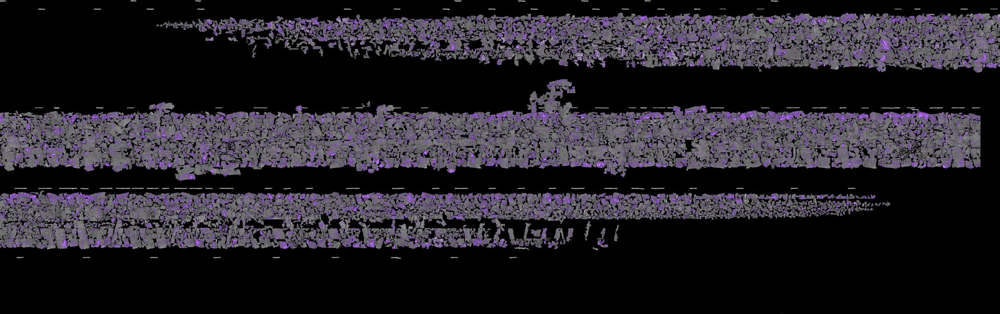
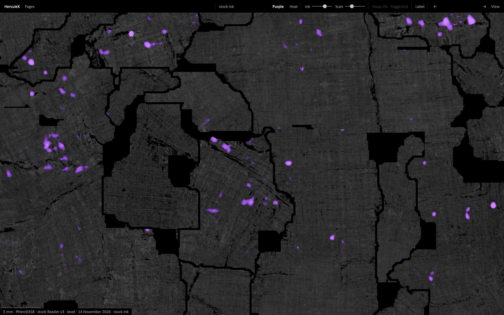
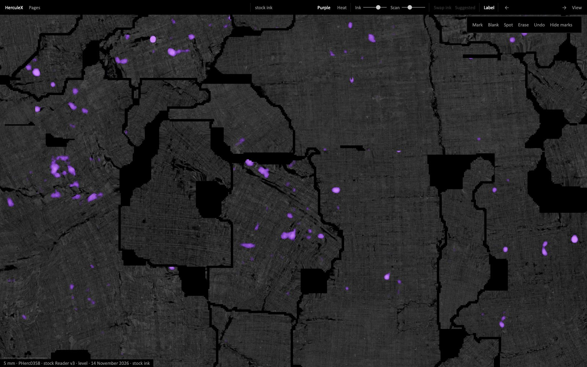

<div align="center">
  
</div>
<hr>
<div align="center">
  <a href="https://scrollprize.org"></a>
  <a href="https://huggingface.co/domenicor046/reader-v3"></a>
  
  <br>
  
  <a href="LICENSE"></a>
</div>

## Table of Contents

1. [Introduction](#1-introduction)
2. [Pipeline](#2-pipeline)
3. [How It Works](#3-how-it-works)
4. [Results](#4-results)
5. [Unwrapped Scrolls](#5-unwrapped-scrolls)
6. [How to Run Locally](#6-how-to-run-locally)
7. [The Viewer](#7-the-viewer)
8. [Working With Your Agent](#8-working-with-your-agent)
9. [Porting to CUDA](#9-porting-to-cuda)
10. [Repository Layout](#10-repository-layout)
11. [License](#11-license)
12. [Citation](#12-citation)
13. [Contact](#13-contact)

## 1. Introduction

The Herculaneum scrolls were carbonised by the eruption of Vesuvius in 79 AD and cannot be unrolled. The [Vesuvius Challenge](https://scrollprize.org) scans them with X-ray CT, publishes the scans, and awards prizes for reading them: First Letters prizes for ten letters in 4 cm² of a scroll still rolled, and the Grand Prize for passages.

HerculeX takes one scroll's CT scan from the open data and, on one MacBook Pro (M1 Pro, 16 GB), turns it into the scroll's sheet unwrapped into flat pieces laid along the roll, an ink map of every piece, and a local website where the whole unrolled scroll can be read at full resolution. A scroll scanned at 9.4 µm takes about two hours from CT to a laid-out sheet, and two to five hours more for the ink, most of it spent downloading 170 to 400 GiB of CT.

The surfaces are made from the CT alone: no published segmentation, mesh or surface prediction enters the pipeline (the published scroll axis is used where a scan has one). Ink is read with [Reader v3](https://huggingface.co/domenicor046/reader-v3), an open model fine-tuned from the Vesuvius Challenge `ink_9um` network.

## 2. Pipeline

```text
CT scan (OME-Zarr, open data, fetched by byte range)
 │  scans/            the survey scan of each scroll, CT bricks fetched as needed
 ▼
sheet nodes          unwrapping/detection   one node per sheet crossing per 8-voxel cell, with its normal (Metal)
 ▼
pieces               unwrapping/level       exact integer winding levels; single-sheet pieces flattened isometrically
 ▼
laid-out sheet       unwrapping/level       one frame per scan: every piece placed along the roll
 ▼
layer stacks         sampling/              31 layers along each piece's normals; the written face found from its fibres
 ▼
ink maps             ink/                   Reader v3 on 17 layers: 3D stem on Metal, 2D body on the Neural Engine
 ▼
scroll page          website/               lossless tile pyramid, zoomable viewer, its card on the start page, hand marks
```

Every stage writes atomic units with a record of the code that made them, so any stage resumes where it stopped and reruns only what a code change affects. Long jobs go through a job board that shares the one GPU, Neural Engine and network link of the laptop ([runner/README.md](runner/README.md)).

## 3. How It Works

### 3.1 Sheet nodes

At about 19 µm per voxel (level 1 of a 9.4 µm scan) the scan is cut into 8-voxel cells. In each cell the structure tensor of the CT over a 24-voxel window gives the local sheet normal *n*, and the CT profile along *n* gives one peak per sheet crossing the cell. Each peak with a prominence of at least 3 grey levels becomes a node: position, normal, prominence, width and coherence. One Metal threadgroup handles one cell; a C implementation of the same arithmetic is the reference the GPU is tested against.

### 3.2 The sheet graph

Nodes of neighbouring cells whose normals agree within 30° and that lie on one surface (within 4 voxels along the normal) are joined by *sheet edges*: they are the same sheet. From every node a *ray* runs along its normal through a 6-voxel tube for up to 40 voxels; the first sheet it meets lies one turn further out. Normals are first made to agree along sheet edges, then the whole graph is turned to face out of the body by one minimum cut.

### 3.3 Exact integer levels

Unwrapping is the assignment of an integer winding level $f$ to every patch of nodes: the turn of the spiral it lies on. Patches merge on the evidence summed between them (sheet edges attract, rays repel), and the levels then solve

$$
\min_{f \in \mathbb{Z}^{P}} \sum_{(a,b,k)} w_{ab}\,\rho\left(f_b - f_a - k\right)
$$

with $k = 0$ for a sheet edge and $k$ the number of sheets crossed for a ray. $\rho$ is the absolute value, except that a ray only bounds the gap from below (it can miss a faint sheet), so a residual on its permitted side costs half. The objective is L1 over differences, so its linear program is the dual of a minimum-cost flow and has integral optima: a network simplex in C solves it exactly and certifies the optimum. The sense of winding (the curl) is chosen by solving both senses and keeping the cheaper. Eight solves with randomly reweighted votes follow; a piece is a region joined only by edges that all eight keep.

### 3.4 Isometric pieces

Each piece is laid flat in frames carried along its own sheet and written as a [tifxyz](https://github.com/ScrollPrize/villa) grid at the node spacing, each grid node the sheet point at its cell's centre, so neighbouring nodes lie one grid step apart in 3D. Holes up to 3 cells from their edge are bridged by a harmonic fill. A piece passes when at least 70% of its measured neighbour pairs are within 10% of a grid step.

### 3.5 One frame per scan

A scan is processed in units of brick rows. Pieces of neighbouring units are joined across each seam by the sheet edges that cross it, unless certain rays say they lie stacked. One more exact level solve over every piece of the scan gives each piece its turn, and the layout places it along the roll by its turn and its angle about the scroll axis; joined pieces are held rigid as mosaics.

### 3.6 Layer stacks and the written face

Each piece's mesh is smoothed by 1.5 cells and sampled along its normals into a stack of 31 layers, read straight from CT bricks fetched by HTTP range requests. Papyrus is two crossed plies of fibres, so the grain of the near face's outer ply less that of the far face (the log ratio of gradient energy across and along the rows) names the recto: 13 of 14 labelled cases right, none wrong.

### 3.7 Ink

Reader v3 (34.5 M parameters) is a 3D stem over 17 CT layers feeding a 2D residual U-Net. The window starts 8 layers before the steepest fall of the stack's mean profile, the written face. Pieces are read in 512-pixel tiles every 384 pixels; the stem runs as one Metal kernel and the body is compiled once for the Neural Engine in half precision, at 37 ms a tile.

### 3.8 The website

Every layer of a scroll (the scan at the mesh, the brightest voxels across the sheet, the ink) is a tile pyramid packed into one file with an index; the browser reads tiles by byte range and decodes them in WebGL. Level 0 keeps the scan's own values without loss.

## 4. Results

All measurements on one MacBook Pro M1 Pro (10 cores, 16 GB). Where a number was measured on data used to develop the method, it says so.

### 4.1 Eight scrolls, whole

Eight scrolls were unwrapped and read end to end on 13-14 November 2026, one after another on the job board, with stock Reader v3. None of them has published meshes or letters.

| Scroll | Voxel (µm) | Laid out (cm²) | In mosaics ≥ 4 cm² (cm²) | Laid length (m) | CT to laid-out sheet (h) | Ink read with CT download (h) | Page (min) |
| --- | ---: | ---: | ---: | ---: | ---: | ---: | ---: |
| PHerc0358 | 9.36 | 8,507 | 4,991 | 8.9 | 2.0 | 2.6 | 59 |
| PHerc0813 | 9.36 | 8,849 | 4,665 | 7.4 | 2.4 | 3.3 | 63 |
| PHerc0826 | 9.36 | 5,720 | 3,323 | 12.1 | 1.7 | 1.6 | 33 |
| PHerc0846B | 9.36 | 6,064 | 3,521 | 8.9 | 2.0 | 2.4 | 41 |
| PHerc1203 | 9.36 | 7,750 | 4,490 | 6.6 | 2.1 | 2.5 | 51 |
| PHerc0175B | 8.64 | 10,824 | 5,359 | 12.4 | 4.7 | 4.8 | 65 |
| PHerc0125 | 9.36 | 9,801 | 6,631 | 8.7 | 1.3¹ | 4.7 | 41 |
| PHerc0191 | 9.36 | 11,775 | 6,450 | 9.1 | 1.7¹ | 5.0 | 46 |
| **Total** | | **69,290** | **39,428** | | | | |

¹ Sheet detection of these two ran before the run and is not included.

- Every stage peaked at 2.9 to 8.4 GB of memory but one (15.9 GB, the pieces of PHerc0358).
- A read moves 170 to 403 GiB of CT, deleted once read: 1.0 to 1.7 s per cm² of sheet. Sheet detection is bound by the download too (6 to 23 min of GPU time against 26 to 102 min of transfer per scan).
- Each scroll keeps 16 to 32 GB of viewer tiles and 2 to 5 GB of pieces and nodes.
- The only scroll with an estimate of its total sheet, PHerc0211 (about 14,000 cm², 10,000 to 20,000), had 52% of it laid out by an earlier version of the same route.

### 4.2 Geometry

| Measure | Result | On | Status |
| --- | --- | --- | --- |
| Neighbouring grid nodes within 10% of a grid step in 3D | 81-86% of pairs (87-90% between measured nodes); 96-99% of pieces pass | all 82,550 written pieces of the eight scrolls | needs no truth |
| Correct share / wrong-wrap share against published meshes | PHerc1667 0.716 / 0.046, PHerc0139 0.625 / 0.064, PHercParis4 0.747 / 0.087 | crops with expert meshes | development controls, earlier version of the route |
| Known letters reached by the surface | 91% of the nodes of PHerc0343's published First Letters; ≥ 80% of 29 and ≥ 50% of about 56 hand-labelled letters | PHerc0343; 14 labelled cases | |
| Ink read through the surface, against the published mesh with the same reader | correlation 0.571 against 0.642 (89%) | the PHerc0343 First Letters crop | earlier version of the route |

### 4.3 Ink on holdouts and known scrolls

AUC of ink against hand labels, read on HerculeX's own surfaces unless the column says published.

| Test | Stock Reader v3 | Reader v3 post-trained on HerculeX surfaces | Status |
| --- | --- | --- | --- |
| PHerc0814, 52 letters | **0.870**; 6.6% of nearby blank called ink | 0.840-0.851; 14.7-25.9% | held out of post-training |
| Second tier: PHerc0814, 22 letters / PHerc0841, 6 letters | **0.935** / **0.926** | 0.887-0.930 / 0.873-0.889 | held out of post-training |
| PHerc0841, 31 labelled cases | 0.792 at one depth, 0.817 averaged over depths, 0.829 at the best depth in -4..+4 | | never seen by Reader v3 |
| PHerc0841, where hand label and fine-scan map agree: published / HerculeX | 0.955 / 0.922 | 0.943 / 0.905 | post-training saw PHerc0841 |
| 62 known letters: published / HerculeX | median 0.994 / 0.956 (0.969 averaged over five depths) | | includes PHerc0139, which Reader v3 has likely seen |

Stock Reader v3 beats every post-trained variant on the holdout and calls less than half as much blank papyrus ink, so the pipeline reads with it. Reads are also checked against invention: in a whole read of PHerc0211, the scrambled twins of 5,873 stacks (spectrum and depth profile kept, structure destroyed) gave no sure ink in 5,849.

### 4.4 Limits

- No passage of ten letters has yet been read on HerculeX surfaces alone. On known passages the surfaces put ink near the letters but lose some of their shape, and a high AUC does not make letters legible.
- Whether pieces lie on the right wrap is not measured on the eight scrolls above (none has published meshes). The scan frame keeps 13 to 22% of the joints across unit seams, so a large mosaic may join two wraps and order along the roll is approximate.
- The geometry scores against published meshes come from the development controls; no geometry holdout has been declared for this route yet.

## 5. Unwrapped Scrolls

Each picture is one scroll's whole sheet as the pipeline unrolled it, seen from the written face, cut into shelves to fit the page, with the ink in purple. Scan data: Vesuvius Challenge.

<p><br><sub>PHerc0358: 8,507 cm² laid out over 8.9 m</sub></p>
<p><br><sub>PHerc0191: 11,775 cm² laid out over 9.1 m</sub></p>
<p><br><sub>PHerc0175B: 10,824 cm² laid out over 12.4 m</sub></p>
<p><br><sub>PHerc0125: 9,801 cm² laid out over 8.7 m</sub></p>
<p><br><sub>PHerc0813: 8,849 cm² laid out over 7.4 m</sub></p>
<p><br><sub>PHerc1203: 7,750 cm² laid out over 6.6 m</sub></p>
<p><br><sub>PHerc0846B: 6,064 cm² laid out over 8.9 m</sub></p>
<p><br><sub>PHerc0826: 5,720 cm² laid out over 12.1 m</sub></p>

`./run.sh website.overview PAGE OUT.jpg` draws any published scroll this way.

## 6. How to Run Locally

### 6.1 Requirements

- A Mac with Apple silicon; developed on an M1 Pro with 16 GB. Xcode Command Line Tools (`xcode-select --install`) for the C, Objective-C and Metal kernels, which compile on first use.
- [uv](https://docs.astral.sh/uv/) for Python 3.11 and the locked dependencies.
- Disk: about 40 GB kept per scroll, plus 25 GB of headroom for CT in flight. An external drive works (see 6.3).
- A fast network link: a whole-scroll read downloads 170 to 400 GiB of CT.

### 6.2 Install

```sh
git clone https://github.com/adambetka2/HerculeX.git && cd HerculeX
UV_PROJECT_ENVIRONMENT=runtime/python uv sync --locked --extra ink
./run.sh ink.model.weights fetch        # Reader v3 (MIT), pinned and checked by SHA-256
./run.sh check cpu                      # the tests that need neither GPU nor Neural Engine, about 5 min
```

### 6.3 Data folders

Everything the pipeline reads or writes lives in two folders, set in [`storage/data_roots.py`](storage/data_roots.py):

```text
data/library/    what the pipeline reads and knows: scan catalogue, model weights, labelled datasets, hand marks
data/outputs/    what it makes: sheet nodes, pieces, layouts, layer stacks, the website
```

`HERCULEX_DATA=/Volumes/Big/HerculeX` moves both; `HERCULEX_LIBRARY` and `HERCULEX_OUTPUTS` move either one. A symlink in `data/` works too. Nothing else needs configuring: the scan catalogue, the CT and the model code and weights are fetched on first use at pinned revisions.

The local databases are plain files beside the data: `outputs/unwrapping/level_route.sqlite` indexes every finished unit (rebuilt from their records by `./run.sh runner.pipeline index`), `library/marks/` holds the hand marks as append-only logs, `library/studies/shared/spot-candidates/db/` the Parquet tables of circled spots and their verdicts, and `runtime/board/board.sqlite` the job board.

### 6.4 Unwrap a scroll

Three jobs on the board, each starting when the one before finishes:

```sh
S=PHerc0826
./run.sh board add $S-sheets --gpu --link --share --memory 5 --setting HERCULEX_LIST_CT_BRICKS=1 -- \
  ./run.sh runner.pipeline run sheets $S
./run.sh board add $S-pieces --memory 5 --cores 3 --restartable --after $S-sheets -- \
  ./run.sh runner.pipeline run pieces $S
./run.sh board add $S-sheet --gpu --engine --link --memory 5 --cores 5 --after $S-pieces --setting HERCULEX_KEEP_STACKS=0 -- \
  ./run.sh runner.pipeline run sheet $S
./run.sh board status
```

The last job reads every piece and publishes the scroll: its page appears on the start page with no further step. Any stage can be stopped and resumed. `./run.sh runner.pipeline run all $S` runs the same three stages without the board.

### 6.5 Open the website

```sh
./run.sh website.site_server            # http://localhost:8765/sheets/index.html
```

## 7. The Viewer

<p></p>

The start page has one card per scroll, labelled `scroll · ink model · surface · date`, and the total read so far. A card opens the scroll's page: the whole unrolled sheet in shelves, zoomable from the full scroll down to one voxel per pixel. The yellow outline is the current place, here the largest continuous area; green outlines are circled spots.

<p></p>

<p> </p>

| Mode | What it shows | Keys |
| --- | --- | --- |
| Purple / Yellow | ink above a floor, over the scan | `Y`; `,` `.` move the floor; `;` `'` dim or brighten the scan |
| Heat | the ink's strength in colour, weak to strong | `I` |
| Layers | the scan at the mesh, the brightest voxels across the sheet, the ink | `↑` `↓` |
| Places | the largest continuous areas, largest first | `N` `P` |
| Suggested | windows proposed for a first look, where a page has them | `J` |
| Swap ink | a second read (another model or depth) over the same sheet | `T` |
| Label | mark ink, mark blank, circle a spot, erase, undo | `G`/`M`, `C`, `X`, `Z`, `L` |
| View | fit, one voxel per pixel, mirror, turn, invert, Greek letters from the scrolls, full screen | `0`, `H`, `U`, `K`, `F` |

Move with `W` `A` `S` `D`, zoom with `E` `R`, or drag; `?` lists every key. Marks are saved as they are drawn, one JSON line each, with the exact placement of the pieces they were drawn on, so they stay attached to the scan when a layout changes.

<p></p>

## 8. Working With Your Agent

HerculeX is built to be driven by a coding agent while you read. [`AGENTS.md`](AGENTS.md) is the agent's page: commands, rules and recipes in one screen, with the module READMEs one level down. The loop:

1. Ask the agent to unwrap a scroll ("unwrap PHerc0826"). It queues the three jobs of 6.4.
2. When the read finishes, the pipeline publishes the scroll's page and adds its card to the start page. Pages made any other way (a rebuilt surface, a read by another model) are added with one command, `./run.sh website.site_pages card PAGE`, which labels the card from the page itself; nobody edits the website by hand.
3. Read the scroll in the viewer. Circle places that may hold letters with the Spot tool (`C`); mark ink (`G`) and blank papyrus (the Blank tool) where you are sure.
4. Ask the agent to work on your circles, and keep reading. It builds the spots table from your marks, rebuilds each spot as a continuous surface, reads it at every depth from -15 to +15 with several models, and publishes a sweep page per spot at `/sheets/spot-candidates/` where you choose the depth and record a verdict ([spots/README.md](spots/README.md)). The jobs queue behind each other on the board, so you can keep marking.

## 9. Porting to CUDA

HerculeX is tuned for Apple silicon: 16 GB of unified memory, one Metal GPU and the Neural Engine. Everything above the kernels is plain Python, NumPy and C. To run it on an NVIDIA machine, fork it and give your coding agent this:

```text
Port HerculeX to Linux with one CUDA GPU. Keep every stage's output identical within the tolerances its tests use.
1. unwrapping/detection: write a CUDA kernel for gpu_nodes.metal (one block per 8-voxel cell, the same Node record);
   cpu_nodes.py and node_kernels.c are the reference; tests/test_sheet_nodes_golden.py compares the two.
2. ink/model: replace depth_stem.metal with the PyTorch stem it reproduces, and the Neural Engine body
   (neural_engine.py, engine_calls.m, Core ML) with the PyTorch body in float16 on CUDA; keep tile_reader.py's
   tiling, norms and blending. Change device "mps" to "cuda".
3. runner/compiled_kernels.py already builds the C kernels with cc on Linux; drop the Objective-C sources.
4. runner/job_board.py: one GPU slot, no engine slot; raise memory sizes to the new machine.
5. Run ./run.sh check, then one scroll end to end, and compare its record.json files and page with a Mac run.
```

MLX and Core ML appear only in optional readers (`hecate_mlx.py`, `hecate_engine.py`) and can be dropped.

## 10. Repository Layout

```text
scans/            scan catalogue of the open data, byte-range fetches into brick stores
unwrapping/       detection (sheet nodes), level (pieces, frame, layout), layout (mosaics, tifxyz export)
sampling/         layer stacks along normals, the written face from fibres
ink/              model (Reader v3, tile reader, Neural Engine), reading, datasets, training
website/          tile pyramids, viewer, start page, local server, hand marks, overview pictures
spots/            circled spots to depth sweeps, verdicts and a submission
calibration/      every stage scored on controls with known truth
runner/           pipeline route, job board, compiled kernels
storage/          data folders and binary formats
records/          measured results the calibration studies write and read
tests/            end-to-end tests on synthetic scrolls, and golden tests of fast paths against references
docs/             images and the generator of the title art
```

Each folder has a short README with its files, commands and outputs.

## 11. License

The code is released under the [MIT License](LICENSE). Reader v3 (Domenico Russo) and the Vesuvius Challenge `ink_9um` network and `villa` code are MIT-licensed and fetched at pinned revisions. Scan data and the published products are the Vesuvius Challenge's, under their own terms. The title art is drawn by [`docs/art/minoan.js`](docs/art/minoan.js).

## 12. Citation

```bibtex
@software{herculex2026,
  author = {Betka, Adam},
  title  = {HerculeX: unwrapping Herculaneum scrolls from CT on one laptop},
  year   = {2026},
  url    = {https://github.com/adambetka2/HerculeX}
}
```

## 13. Contact

Questions and reports are welcome as [GitHub issues](https://github.com/adambetka2/HerculeX/issues).
