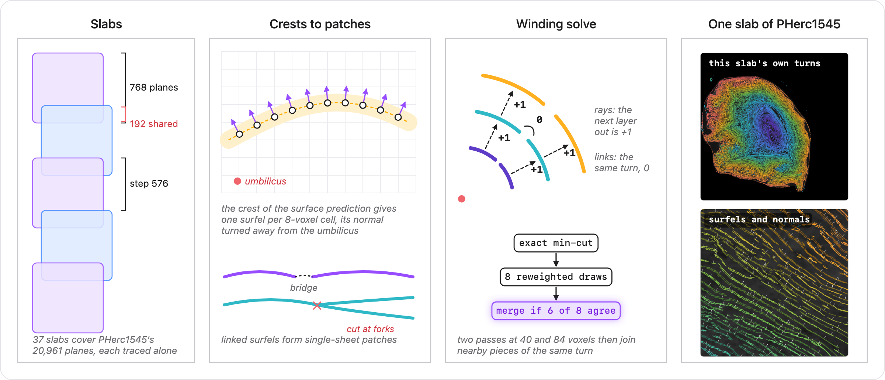
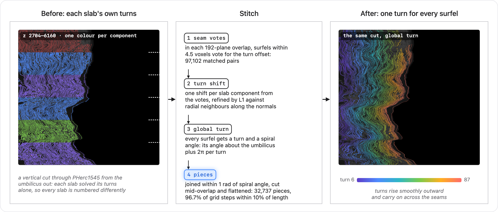
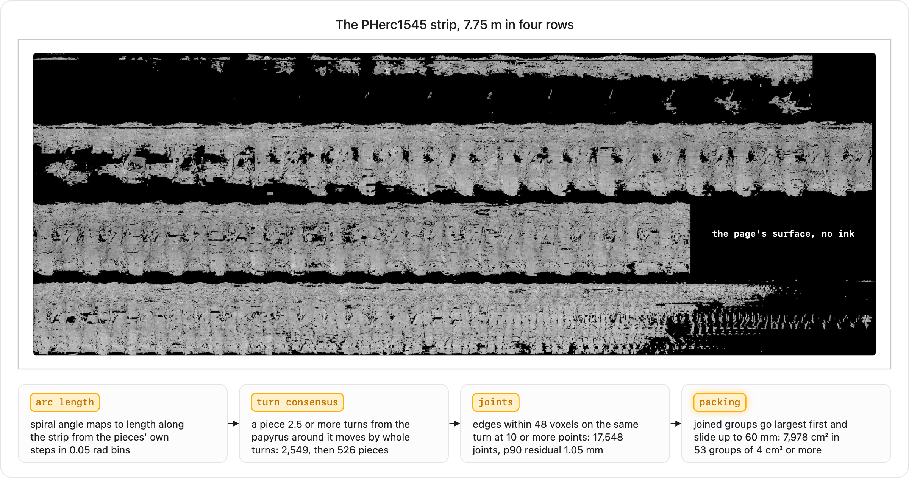
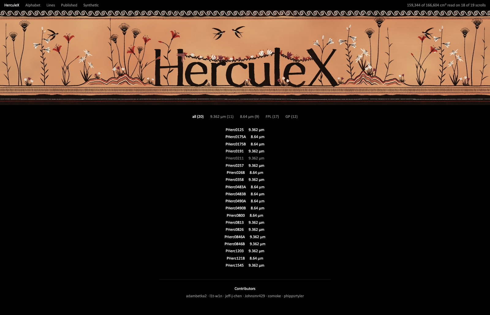
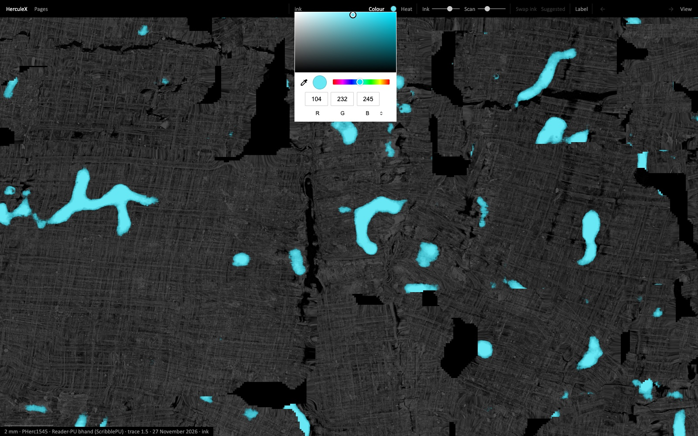
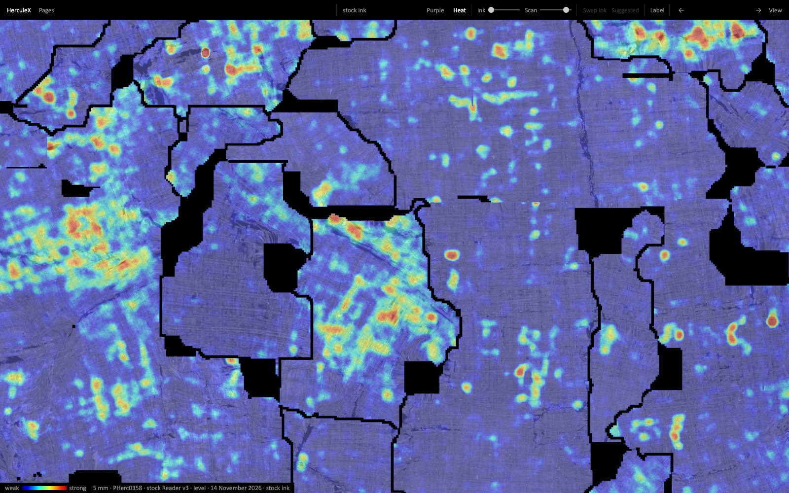

<div align="center">
  
</div>

HerculeX is a modular framework for virtually unwrapping carbonized Herculaneum scrolls from X-ray CT and reading their ink. The newest version of HerculeX introduces the trace 1.5 engine for whole-scroll unrolling and reading. You can also use level 1.1 as an alternative — a rewrite and improvement to level 1.0 with added curl setup, umbilicus tracking, and a rewrite in C for faster unrolling.

- **Two interchangeable fits.** `./run.sh unwrap` runs trace 1.5 from a surface prediction; `./run.sh level` runs the
  level 1.1 detector and exact winding fit directly from CT.
- **Exact winding.** Both engines solve winding as an integer optimization problem to proven optimality rather than greedily growing surfaces.
- **Isometric surfaces.** Flattened pieces preserve true 3D lengths: 96.7% of neighboring grid steps lie within 10% of their 3D length on PHerc1545 (trace 1.5) and 84–93% on PHerc1545/PHerc1667 units (level 1.1).
- **Runs on a laptop or GPU server.** Level 1.1 unwraps a 9.4 µm scroll in about two hours on an M1 Pro MacBook Pro (16 GB RAM); trace 1.5 runs in ~64 s per slab on an RTX 5090.
- **Local viewer and annotation.** HerculeX, as an end-to-end framework, is useful for finding interesting sectors for the First Letters Prize or annotating letters for ink model training. Eventually its purpose is to unroll and read whole scrolls of the Vesuvius Challenge, and then go beyond that to understand the mysteries of thousands of buried Herculaneum scrolls.

## Overview

Carbonized by the eruption of Mount Vesuvius in 79 AD, the Herculaneum scrolls cannot be unrolled. The [Vesuvius Challenge](https://scrollprize.org) publishes their X-ray CT scans and awards prizes for reading them. HerculeX takes a scroll's open-data OME-Zarr scan through five stages:

| Stage | Module | What it does |
| --- | --- | --- |
| 1. CT scan | [`scans/`](scans/README.md) | Choose the scan and fetch OME-Zarr CT bricks on demand by byte range. |
| 2. Surface fit | [`unroll/`](unroll/README.md) or [`level/`](level/README.md) | **Trace 1.5** (`unroll/`): trace 768-slice slabs, stitch global windings into `tifxyz` segments, lay out one strip. **Level 1.1** (`level/`): detect nodes directly from CT and solve exact winding levels. |
| 3. Surface volumes | [`sampling/`](sampling/README.md) | Sample 31 normal-offset layers along each `tifxyz` piece and select the recto (written face) from fiber direction. |
| 4. Ink maps | [`ink/`](ink/README.md) | Run Reader v3, Reader-PU, Studio, Jeff's Studio post-train, or a local checkpoint. |
| 5. Scroll page | [`viewer/`](viewer/README.md) | Compose a lossless tile pyramid, open the WebGL2 viewer, and add the build to the start page. |

## Trace 1.5 method

<p></p>

Trace 1.5 unwraps a whole scroll in three stages: **trace** (`unroll-trace`) solves integer windings independently on overlapping volumetric slabs; **stitch** (`unroll-stitch`) reconciles per-slab windings into one global scroll numbering and flattens isometric `tifxyz` segments (pieces); and **layout** (`layout.py`) aligns touching same-winding pieces into one continuous strip for ink reading. On PHerc1545 (`9.36 µm`), Trace 1.5 lays out **9,659 cm²** as a **7.75 m** strip (`40.0 cm²` largest piece, **5,681 cm²** largest joined area, `7,978 cm²` in joined groups ≥ 4 cm²), compared with **8,836 cm²** (`2.64 cm²` largest piece, **373 cm²** largest mosaic) from Level 1.1. See the [unroll guide](unroll/README.md) for every stage, CLI flag, and setting.

### 1. Trace each slab

<p></p>

1. **Slabs:** Divides the volume into independent slabs of 768 z-slices advancing by 576 z-slices (192-slice overlap), so slabs of one scroll can run in parallel across GPUs or machines.
2. **Crests to patches:** Extracts one surfel per 8-voxel cell along the surface-prediction crest with its normal oriented away from the umbilicus, links neighboring surfels into single-sheet patches, cuts links where predictions fork, and bridges small gaps.
3. **Winding solve:** Normal rays vote `+1` to the next winding outward while in-sheet links vote `0`. An exact parametric min-cut solves every patch's integer winding across **8 reweighted draws**, merging two patches only when **≥ 6 of 8 draws agree**, followed by two same-winding consolidation passes at 40 and 84 voxels.

A PHerc1545 slab holds 15–18 million surfels and traces in **64 s** on an RTX 5090 (after a 155 s S3 fetch), or ~15 minutes on an M1 Pro CPU.

### 2. Stitch one scroll

<p></p>

Because each slab numbers its own windings independently (left), stitching reconciles them into a single continuous global winding across seams (right):

1. **Seam votes:** Across every 192-slice overlap, surfels within 4.5 voxels vote on the integer winding offset between adjacent slabs (`97,102` matched pairs on PHerc1545).
2. **Winding shift:** Solves one global integer shift per slab component from the seam votes and refines it by L1 optimization against radial neighbors along the normals.
3. **Global winding:** Assigns every surfel a global winding number and spiral angle (azimuth around the umbilicus plus `2π` per winding).
4. **Pieces (`tifxyz` segments):** Joins surfels within `1 rad` of spiral angle into pieces, cuts at the midpoint of each overlap, and flattens them isometrically. PHerc1545 yields `32,737` pieces; weighted by area, **96.7%** of neighboring grid steps lie within 10% of their true 3D length.

### 3. Lay out one strip

<p></p>

1. **Arc length:** Maps each piece's spiral angle to physical position along the strip by integrating step lengths in `0.05 rad` bins.
2. **Winding consensus:** Shifts any piece sitting `≥ 2.5` windings away from surrounding papyrus by integer windings (two rounds moved `2,549` and then `526` pieces on PHerc1545).
3. **Joints:** Joins same-winding piece edges that come within 48 voxels at `≥ 10` contacts (`17,548` joints on PHerc1545) and aligns them in one global least-squares solve (`p90` residual **1.05 mm**).
4. **Packing:** Packs joined groups largest-first (allowing up to 60 mm slide) into four rows (`7,978 cm²` in 53 groups ≥ 4 cm²). On PHerc1545, 16.9% of the strip is covered more than once, mostly where folds cross the same spiral angle twice or residual winding errors remain.

The figures are drawn from the PHerc1545 run by [`docs/source/unroll/render.sh`](docs/source/unroll/render.sh).

## Level 1.1 method

| Step           | Method                                                                                                                                                                                                                       |
| -------------- | ---------------------------------------------------------------------------------------------------------------------------------------------------------------------------------------------------------------------------- |
| Sheet nodes    | In each 8-voxel cell, the structure tensor gives the sheet's orientation, and each peak of the CT profile along the normal becomes a node.                                                                                   |
| Sheet graph    | Nodes join along a sheet where their normals agree, and a ray along each normal meets the next winding outward. One minimum cut turns every normal out of the scroll.                                                               |
| Winding levels | Every patch of nodes gets an integer winding number of the spiral, solved exactly (below) and repeated with reweighted votes; pieces keep only the edges that every solve keeps.                                                       |
| Pieces         | Each piece is laid flat along its own sheet and written as a [tifxyz](https://github.com/ScrollPrize/villa) segment grid whose neighbors lie one grid step apart in 3D.                                                              |
| Layout         | Pieces join across unit seams, and one more exact solve over the scan places each piece by its winding and its angle along the roll.                                                                                            |
| Ink            | The fiber direction of the outer layer identifies the recto (written face), and [Reader v3](https://huggingface.co/domenicor046/reader-v3) (default) or Reader-PU reads a 17-layer surface-volume window from it (Studio reads 16 layers). |

The winding levels $f$ minimize a weighted L1 norm over the evidence between patches,

$$
\min_{f \in \mathbb{Z}^{P}} \sum_{(a,b,k)} w_{ab}\,\left|f_b - f_a - k\right|
$$

where $k = 0$ for a sheet edge and $k$ is the number of sheets a ray crosses. The linear program of this objective is the dual of a minimum-cost flow and has integral optima, so a network simplex solver finds the exact optimum and certifies it.

The [atlas](docs/atlas.md) maps the challenge's tools, checkpoints and data releases from CT to readable papyrus, and
what to measure at each step.

## Level 1.1 results

These level 1.1 scrolls were unwrapped and read end to end, one after another, on one M1 Pro MacBook Pro
(10 cores, 16 GB of memory). None has published meshes.

| Scroll     | Voxel size (µm) | Laid out (cm²) | In mosaics of 4 cm² or more (cm²) | CT to laid-out sheet (h) | Ink maps (h) |
| ---------- | --------------: | -------------: | --------------------------------: | -----------------------: | -----------: |
| PHerc0125  |            9.36 |          9,801 |                             6,631 |                     1.3¹ |          4.7 |
| PHerc0175B |            8.64 |         10,824 |                             5,359 |                      4.7 |          4.8 |
| PHerc0191  |            9.36 |         11,775 |                             6,450 |                     1.7¹ |          5.0 |
| PHerc0358  |            9.36 |          8,507 |                             4,991 |                      2.0 |          2.6 |
| PHerc0813  |            9.36 |          8,849 |                             4,665 |                      2.4 |          3.3 |
| PHerc0826  |            9.36 |          5,720 |                             3,323 |                      1.7 |          1.6 |
| PHerc0846B |            9.36 |          6,064 |                             3,521 |                      2.0 |          2.4 |
| PHerc1203  |            9.36 |          7,750 |                             4,490 |                      2.1 |          2.5 |
| **Total**  |                 |     **69,290** |                        **39,428** |                          |              |

¹ Sheet detection for these scrolls ran separately and isn't included. Ink map times include downloading the CT.

On scrolls without published meshes, nothing yet measures whether each piece lies on the right wrap, and a large mosaic can join two wraps across a unit seam.

## Unwrapped scrolls

Each picture shows one scroll's whole sheet as HerculeX unrolled it, seen from the written face and cut into rows to fit the page. The ink is shown in purple. Scan data: Vesuvius Challenge.

<p><br><sub>PHerc0191: 11,775 cm² laid out</sub></p>
<p><br><sub>PHerc0125: 9,801 cm² laid out</sub></p>

## Get started

HerculeX chooses one of two hardware lanes for your machine and writes to the same data folders. Both lanes run
`level 1.1`, ink reading, and the viewer with native GPU acceleration (Metal/Core ML on `apple`, CUDA/cuDNN on `cuda`).
**Trace 1.5 (`unroll/`) is GPU-accelerated on `cuda` only** — `unroll-trace` and `unroll-stitch` have no Metal backend
and run on CPU only on Apple silicon (~15 min/slab on an M1 Pro vs ~64 s/slab on an RTX 5090), though the downstream
`read` and `page` stages still use Apple Metal/Core ML.

| Lane    | Machine                            | GPU-accelerated stages                                                                                | You need                                                                                                                                       |
| ------- | ---------------------------------- | ----------------------------------------------------------------------------------------------------- | ---------------------------------------------------------------------------------------------------------------------------------------------- |
| `cuda`  | Linux with one or more NVIDIA GPUs | Trace 1.5 (`unroll-trace`, `unroll-stitch`), level 1.1, ink reading                                   | NVIDIA driver, GCC, CUDA toolkit, cuDNN development files; Python 3 (`numpy`, `scipy`, `pillow`) for trace 1.5, plus `torch` for Studio models |
| `apple` | A Mac with Apple silicon           | Level 1.1, ink reading (trace 1.5 tracing/stitching runs on CPU only, or offload slabs to CUDA/Colab) | Xcode Command Line Tools; Python 3 (`numpy`, `scipy`, `pillow`) for trace 1.5, plus `torch` for Studio models                                  |

```sh
git clone https://github.com/adambetka2/HerculeX.git
cd HerculeX
./run.sh setup
./run.sh catalog PHerc0826
./run.sh curl PHerc0826 SCAN SIGN
./run.sh unwrap PHerc0826:SCAN
```

Replace `SCAN` with the scan ID from `./run.sh catalog` and `SIGN` with the scroll's hand-verified curl (`1` if radius grows as `atan2(y - cy, x - cx)` increases, `-1` if it shrinks; see [curl and umbilicus](level/level/README.md#curl-and-umbilicus)). Trace 1.5 also requires a scan voxel size between `7.5` and `10.0 µm` and a published `m7` surface prediction in the catalog (or `plan --m7 URL`); for scans without one, run `./run.sh level` instead. Scans whose open-data catalog entry includes an umbilicus (such as `PHerc0125` and `PHerc0826`) work out of the box; for other scrolls, place community centerlines in `records/umbilici/vesuvius-center-lines/` or supply an `axis.json` (see [level/level](level/level/README.md#curl-and-umbilicus)). When the read publishes, run `./run.sh serve` and open <http://localhost:8765/sheets/index.html>. The viewer can open pages and tile packs from earlier runs directly.

Run `./run.sh setup spots` before using the spot tools that need DuckDB.

Native setup checks the system libraries with `pkg-config` and installs missing
development packages through Homebrew on macOS or APT when run as root on Linux.
On Linux, install the CUDA toolkit and cuDNN before setup. Set `CUDA_HOME` if your
CUDA toolkit is outside `/usr/local/cuda`.

`unwrap` runs trace 1.5 in the foreground and resumes finished trace units. Add `--queue` to schedule the whole run on
the job board in one command (recommended on a Mac; or offload slab tracing with `./run.sh unroll SCROLL SCAN colab SESSION`
and stitch/read locally). After a failed read, `./run.sh unwrap --queue --from read SCROLL:SCAN` resumes reading and
publication while keeping the earlier stages. Add `--rotate180` when the strip needs turning. See the
[`unroll` stages](unroll/README.md) for individual commands. Run
`./run.sh level PHerc0826:SCAN` instead for level 1.1; on a Mac it queues its stages on the board. A whole read can
download several hundred gigabytes of CT. `HERCULEX_DATA` moves the data folders to another drive.

## Use the viewer

<p></p>

The start page lists scrolls by voxel size and prize eligibility (`FPL`, `GP`). Open a scroll, then a build, to view its whole unrolled sheet and zoom to one voxel per pixel.

<p></p>

<p></p>

Pick any custom ink colour from the swatch beside the tint button (right-click the swatch to restore the page's default) or switch to **Heat** mode to inspect ink strength across the papyrus.

<p></p>

| Mode                                      | Description                                                                                                                                                             | Keys                                             |
| ----------------------------------------- | ----------------------------------------------------------------------------------------------------------------------------------------------------------------------- | ------------------------------------------------ |
| Ink tint (`Yellow` / `Purple` / `Colour`) | Ink above a threshold, over the scan, in the page's purple or yellow or a colour you pick from the swatch beside the button (right-click the swatch for the page's own) | `Y` toggles it; `,` and `.` change the threshold |
| Heat                                      | The strength of the ink in color, from weak (blue) to strong (red)                                                                                                      | `I`                                              |
| Layers                                    | The scan at the surface, the brightest voxels across the sheet, the ink                                                                                                 | `↑` and `↓`                                      |
| Places                                    | The largest continuous areas, largest first                                                                                                                             | `N` and `P`                                      |
| Label                                     | Trace letters, circle an interesting place, erase, undo                                                                                                                 | `G`, `C`, `X`, `Z`                               |
| View                                      | One voxel per pixel, mirror, turn, Greek alphabet reference, full screen (invert is a toolbar button)                                                                   | `0`, `H`, `U`, `K`, `F`                          |

To move, use `W`, `A`, `S` and `D` or drag. To zoom, use `E` and `R` or scroll. Press `?` to list every key.

<p></p>

Click **Label** to trace letters (**Letters**, red) or circle an interesting place (**Spot**, green). The viewer saves each mark the moment you draw it, in millimeters on the unrolled sheet, to an append-only log in `data/library/marks/`, so marks stay tied to the same papyrus after you rebuild the layout.

## Work with your agent

A coding agent can run HerculeX while you read. [`AGENTS.md`](AGENTS.md) explains the project and commands.
Ask it to unwrap a scroll, then circle places in the viewer and ask it to rebuild and read them at every depth or manually correct the segmentation & ink.

## Repository layout

```text
scans/            the scan catalog of the open data and byte-range fetches of CT
unroll/           default trace 1.5 pipeline: trace, stitch, strip layout, preview and shared-stage adapters
level/            level 1.1 pipeline: sheet detection, exact winding fit, pieces and layout
sampling/         layer stacks along each piece's normals, and the written face
ink/              ink stage, Reader v3 / Reader-PU native readers, Studio PyTorch worker & native CUDA engine, and model registry
viewer/           tile pyramids, the viewer, the start page and the local server
spots/            circled spots to depth sweeps and verdicts
calibrate/        unwrapping scored against published meshes, scroll surveys, and text diagnostics
ml-experimental/  experimental ML models outside the default pipeline (logos/ geometry model)
ports/            native Apple silicon ports of external unwrapping tools (lasagna/, scrollfiesta/, spiral/, surface/)
records/          committed calibration measurements (surface/) and optional local centerlines (umbilici/)
runner/           shared lane support, job board and compiled kernels
storage/          data folders and binary formats
synthetic/        procedural 2D/3D CT scroll generators and fragment injection benchmarks
tests/            native unit, golden, and end-to-end checks (including synthetic scroll suites and fast-path checks)
```

Folders that end in `_apple` or `_cuda` hold the code of one lane. The `cuda` lane grew from the first Linux and CUDA
port of HerculeX, by Maksym Lytvynenko. So thank you Maksym for the idea!

## License

HerculeX is released under the [MIT License](LICENSE). `./run.sh setup` runs `./run.sh weights fetch`, which downloads Reader v3 by Domenico Russo (MIT) at a pinned revision; naming another model (`./run.sh weights fetch MODEL`) downloads on demand Reader-PU by Domenico Russo (MIT), Studio by Priyank Aranke (CC BY-NC 4.0), or `studio-jeff` by Jeff Chen (no weight license stated). `./run.sh setup spots` downloads DuckDB (MIT). External ports under `ports/` retain their upstream terms (see [`ports/scrollfiesta/THIRD_PARTY_LICENSES.md`](ports/scrollfiesta/THIRD_PARTY_LICENSES.md) for vendored research-only/non-commercial dependencies). The scan data belongs to the Vesuvius Challenge and is subject to its terms.

## Citation

```bibtex
@software{herculex2026,
  author = {Betka, Adam},
  title  = {HerculeX: virtual unwrapping of Herculaneum scrolls from X-ray CT},
  year   = {2026},
  url    = {https://github.com/adambetka2/HerculeX}
}
```

## Contact

Email adambetka2@gmail.com, or open a [GitHub issue](https://github.com/adambetka2/HerculeX/issues).
