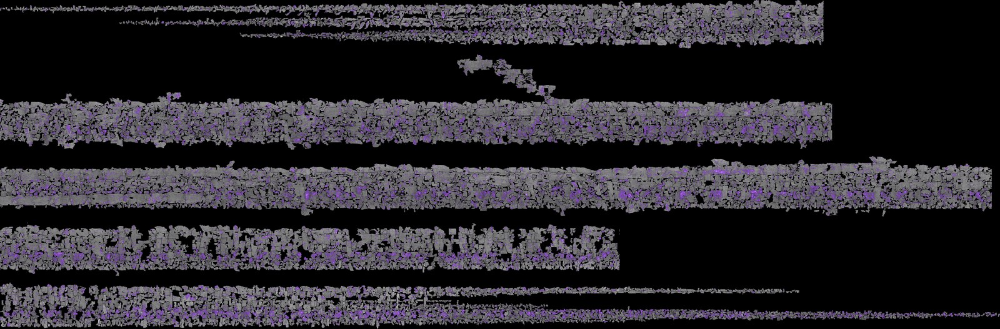
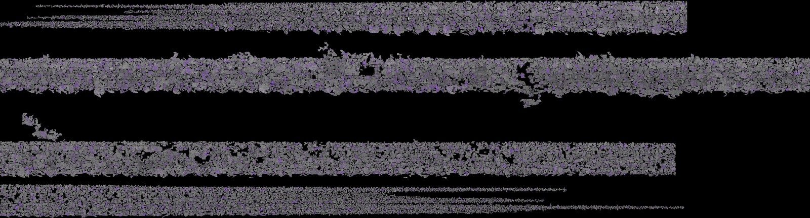
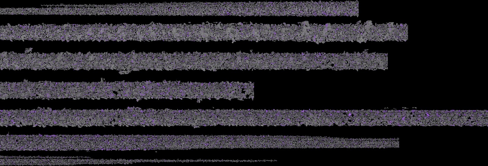
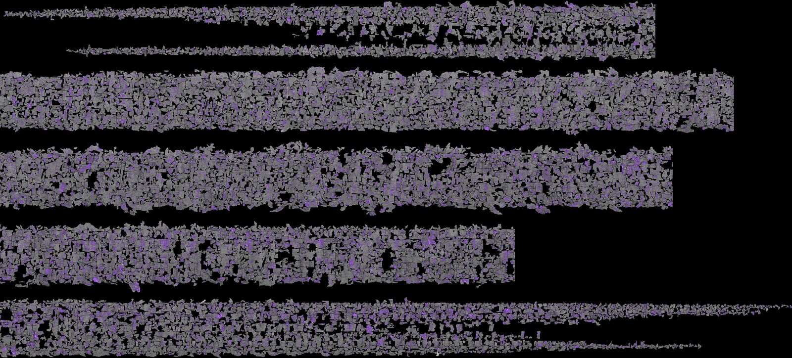
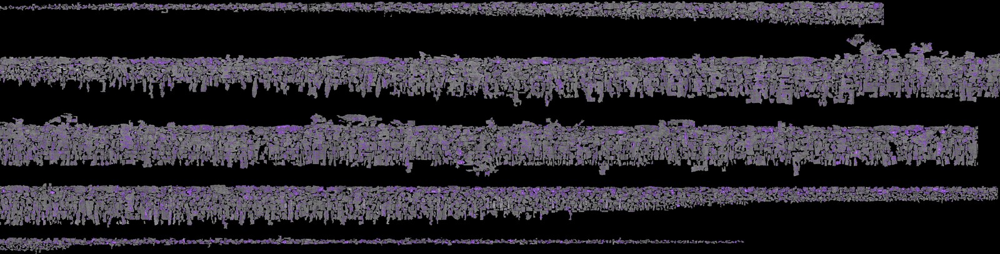
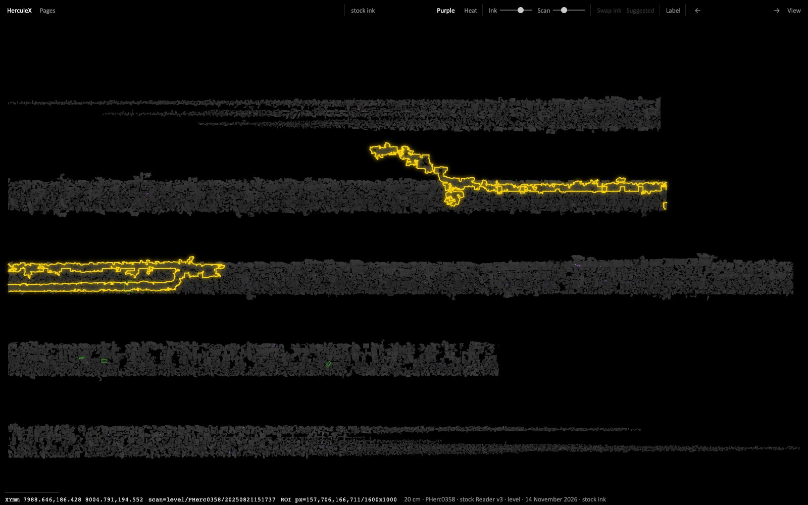
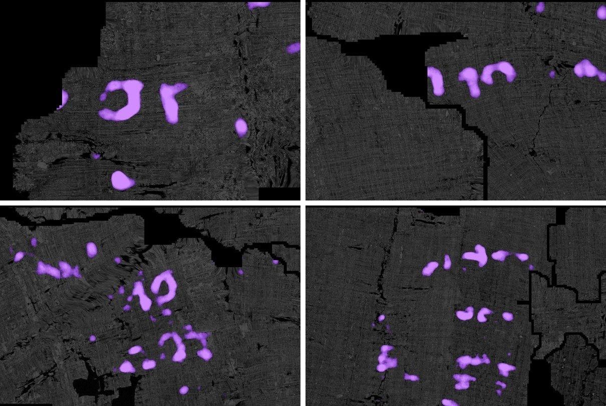

<div align="center">
  
</div>

HerculeX is a framework for the virtual unwrapping of the carbonized Herculaneum scrolls from X-ray CT. It turns a scroll's scan into flat, measurable sheets of papyrus, reads their ink, and serves the result in a local viewer where you and your agents can inspect and label it. It runs on Apple silicon or on Linux with NVIDIA GPUs, and a whole scroll fits on one MacBook Pro.

- **Raw CT in, readable sheet out.** HerculeX needs no manual segmentation, published meshes or surface predictions. It finds the papyrus in the CT and unwraps it automatically.
- **Exact winding.** HerculeX treats unwrapping as an integer optimization problem and solves it to proven optimality, instead of growing surfaces greedily and accumulating errors.
- **Isometric surfaces.** Each piece of sheet keeps its true lengths: 81 to 86 percent of neighboring grid points lie within 10 percent of their true spacing in 3D.
- **Fast on a laptop.** A scroll scanned at 9.4 µm goes from CT to a laid-out sheet in about two hours on a MacBook Pro with an M1 Pro chip and 16 GB of memory.
- **Built to be used.** Every stage resumes where it stopped, and the viewer stores your labels in scan coordinates that agents can act on.

## Overview

The Herculaneum scrolls were carbonized by the eruption of Mount Vesuvius in 79 AD and cannot be unrolled. The [Vesuvius Challenge](https://scrollprize.org) publishes X-ray CT scans of the scrolls and awards prizes for reading them. HerculeX takes one scroll's scan from the open data through these stages:

```text
CT scan (OME-Zarr, open data, fetched by byte range)
 │  scans/                  choose the scan, fetch CT bricks as needed
 ▼
sheet nodes                 unwrapping/detection   a node for each sheet crossing in each 8-voxel cell, with its normal
 ▼
pieces                      unwrapping/level       exact integer winding levels; single-sheet pieces, flattened isometrically
 ▼
laid-out sheet              unwrapping/level       one frame per scan; every piece placed along the roll
 ▼
layer stacks                sampling/              31 layers along each piece's normals; the written face found from fibers
 ▼
ink maps                    ink/                   Reader v3 on Metal and the Neural Engine, or on CUDA
 ▼
scroll page                 website/               a lossless tile pyramid, a zoomable viewer, a card on the start page
```

## How it works

| Step | Method |
| --- | --- |
| Sheet nodes | In each 8-voxel cell, the structure tensor gives the sheet's orientation, and each peak of the CT profile along the normal becomes a node. |
| Sheet graph | Nodes join along a sheet where their normals agree, and a ray along each normal meets the next turn out. One minimum cut turns every normal out of the scroll. |
| Winding levels | Every patch of nodes gets an integer turn of the spiral, solved exactly (below) and repeated with reweighted votes; pieces keep only the edges that every solve keeps. |
| Pieces | Each piece is laid flat along its own sheet and written as a [tifxyz](https://github.com/ScrollPrize/villa) grid whose neighbors lie one grid step apart in 3D. |
| Layout | Pieces join across unit seams, and one more exact solve over the scan places each piece by its turn and its angle along the roll. |
| Ink | The fiber direction of the outer layer tells which face carries the writing, and [Reader v3](https://huggingface.co/domenicor046/reader-v3) reads a 17-layer window from it. |

The winding levels $f$ minimize a weighted L1 norm over the evidence between patches,

$$
\min_{f \in \mathbb{Z}^{P}} \sum_{(a,b,k)} w_{ab}\,\left|f_b - f_a - k\right|
$$

where $k = 0$ for a sheet edge and $k$ is the number of sheets a ray crosses. The linear program of this objective is the dual of a minimum-cost flow and has integral optima, so a network simplex solver finds the exact optimum and certifies it.

The [atlas](docs/atlas.md) maps the challenge's tools, checkpoints and data releases from CT to readable papyrus, and
what to measure at each step.

## Results

These scrolls were unwrapped and read end to end on one MacBook Pro with an M1 Pro chip (10 cores, 16 GB of memory), one after another. None of them has published meshes.

| Scroll | Voxel size (µm) | Laid out (cm²) | In mosaics of 4 cm² or more (cm²) | CT to laid-out sheet (h) | Ink maps (h) |
| --- | ---: | ---: | ---: | ---: | ---: |
| PHerc0125 | 9.36 | 9,801 | 6,631 | 1.3¹ | 4.7 |
| PHerc0175B | 8.64 | 10,824 | 5,359 | 4.7 | 4.8 |
| PHerc0191 | 9.36 | 11,775 | 6,450 | 1.7¹ | 5.0 |
| PHerc0358 | 9.36 | 8,507 | 4,991 | 2.0 | 2.6 |
| PHerc0813 | 9.36 | 8,849 | 4,665 | 2.4 | 3.3 |
| PHerc0826 | 9.36 | 5,720 | 3,323 | 1.7 | 1.6 |
| PHerc0846B | 9.36 | 6,064 | 3,521 | 2.0 | 2.4 |
| PHerc1203 | 9.36 | 7,750 | 4,490 | 2.1 | 2.5 |
| **Total** | | **69,290** | **39,428** | | |

¹ Sheet detection for these scrolls ran separately and isn't included. Ink map times include downloading the CT.

On scrolls without published meshes, nothing yet measures whether each piece lies on the right wrap, and a large mosaic can join two wraps across a unit seam.

## Unwrapped scrolls

Each picture shows one scroll's whole sheet as HerculeX unrolled it, seen from the written face and cut into rows to fit the page. The ink is shown in purple. Scan data: Vesuvius Challenge.

<p><br><sub>PHerc0358: 8,507 cm² laid out</sub></p>
<p><br><sub>PHerc0191: 11,775 cm² laid out</sub></p>
<p><br><sub>PHerc0175B: 10,824 cm² laid out</sub></p>
<p><br><sub>PHerc0125: 9,801 cm² laid out</sub></p>
<p><br><sub>PHerc0813: 8,849 cm² laid out</sub></p>
<p><br><sub>PHerc1203: 7,750 cm² laid out</sub></p>
<p><br><sub>PHerc0846B: 6,064 cm² laid out</sub></p>
<p><br><sub>PHerc0826: 5,720 cm² laid out</sub></p>

## Get started

HerculeX runs in one of two lanes, set by the machine it runs on. Both run the same stages into the same data folders.

| Lane | Machine | You need |
| --- | --- | --- |
| `apple` | A Mac with Apple silicon | Xcode Command Line Tools, [uv](https://docs.astral.sh/uv/) |
| `cuda` | Linux with one or more NVIDIA GPUs | An NVIDIA driver, GCC, [uv](https://docs.astral.sh/uv/) |

```sh
git clone https://github.com/adambetka2/HerculeX.git && cd HerculeX
./run.sh setup                 # the lane's packages and Reader v3
./run.sh unwrap PHerc0826      # CT to a published page
./run.sh website.site_server   # then open http://localhost:8765/sheets/index.html
```

On a Mac, `unwrap` adds the scroll's jobs to a job board that runs each one when the Mac has room for it; follow them with `./run.sh board status`. On an NVIDIA machine, it runs the scrolls you name until their pages are published, with every core and GPU busy. Each scroll needs about 40 GB of disk space, and a whole read downloads several hundred gigabytes of CT. `HERCULEX_DATA` moves the data folders to another drive.

## Use the viewer

<p></p>

The start page shows one card for each scroll. Click a card to open the whole unrolled sheet, from the full scroll down to one voxel per pixel.

<p></p>

<p></p>

Zoom in to read the ink. These letter forms are on PHerc0125 and PHerc0191, at places circled during review.

<p></p>

| Mode | Description | Keys |
| --- | --- | --- |
| Purple or yellow | Ink above a threshold, over the scan | `Y` toggles yellow; `,` and `.` change the threshold |
| Heat | The strength of the ink in color, from weak (blue) to strong (red) | `I` |
| Layers | The scan at the surface, the brightest voxels across the sheet, the ink | `↑` and `↓` |
| Places | The largest continuous areas, largest first | `N` and `P` |
| Label | Mark ink, mark blank papyrus, circle a spot, erase, undo | `G`, `C`, `X`, `Z` |
| View | One voxel per pixel, mirror, turn, invert, full screen | `0`, `H`, `U`, `K`, `F` |

To move, use `W`, `A`, `S` and `D` or drag. To zoom, use `E` and `R` or scroll. Press `?` to list every key.

<p></p>

Click **Label** to mark ink (red), blank papyrus (blue) or a spot that may hold letters (green). The viewer saves each mark the moment you draw it, in millimeters on the unrolled sheet, to an append-only log in `data/library/marks/`, so marks stay tied to the same papyrus after you rebuild the layout.

## Work with your agent

HerculeX is built to be driven by a coding agent while you read. [`AGENTS.md`](AGENTS.md) tells the agent how the project fits together and what to run: ask it to unwrap a scroll, then circle places in the viewer and ask it to rebuild and read them at every depth.

## Repository layout

```text
scans/        the scan catalog of the open data and byte-range fetches of CT
unwrapping/   sheet detection, exact winding levels and pieces, the scan frame and the layout
sampling/     layer stacks along each piece's normals, and the written face
ink/          Reader v3 and the ink stage
website/      tile pyramids, the viewer, the start page and the local server
spots/        circled spots to depth sweeps and verdicts
calibration/  unwrapping scored against published meshes and synthetic scrolls
runner/       the pipeline, each lane's unwrap, the job board and compiled kernels
storage/      data folders and binary formats
tests/        end-to-end tests on synthetic scrolls and checks of fast paths against reference code
```

Folders that end in `_apple` or `_cuda` hold the code of one lane. The `cuda` lane grew from the first Linux and CUDA
port of HerculeX, by Maksym Lytvynenko.

## License

HerculeX is released under the [MIT License](LICENSE). Reader v3 by Domenico Russo and the Vesuvius Challenge `villa` code are MIT-licensed; HerculeX downloads them at pinned revisions. The scan data belongs to the Vesuvius Challenge and is subject to its terms. The title art is drawn by [`docs/art/minoan.js`](docs/art/minoan.js).

## Citation

```bibtex
@software{herculex2026,
  author = {Betka, Adam},
  title  = {HerculeX: virtual unwrapping of Herculaneum scrolls from X-ray CT},
  year   = {2026},
  url    = {https://github.com/adambetka2/HerculeX}
}
```

## Contact

Email adambetka2@gmail.com, or open a [GitHub issue](https://github.com/adambetka2/HerculeX/issues).
