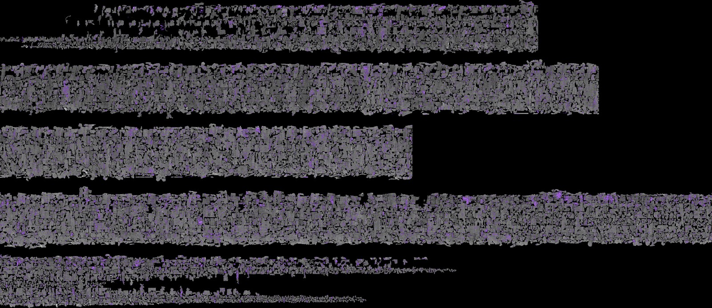
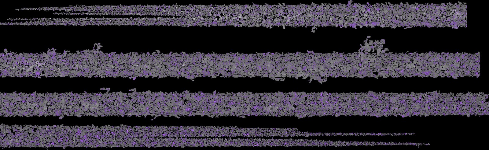
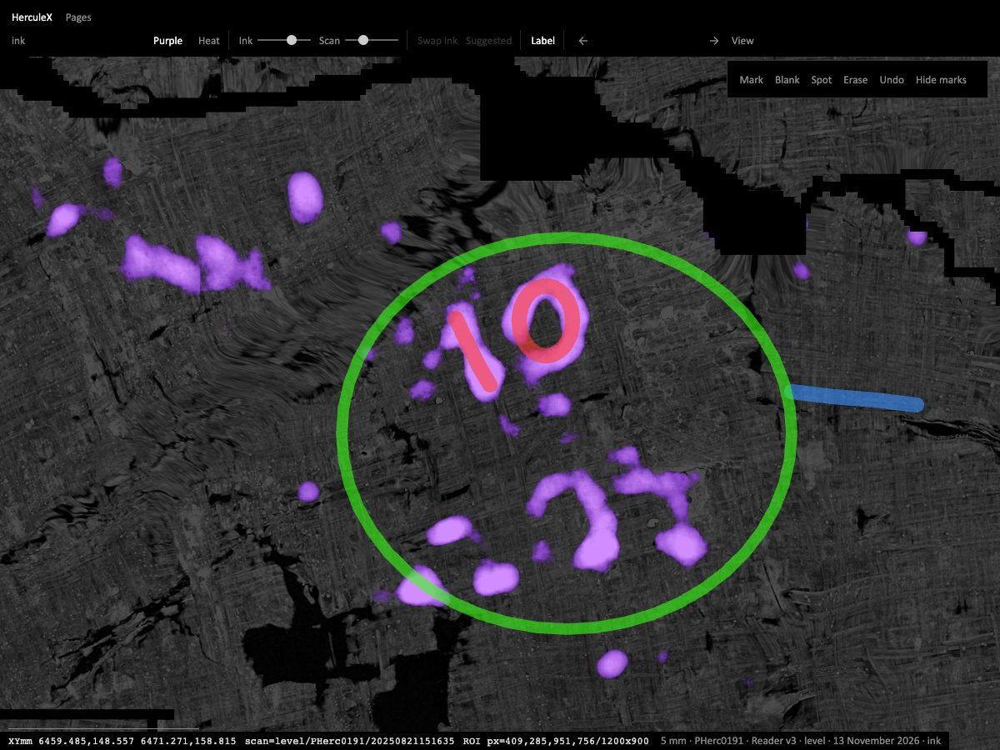

<div align="center">
  
</div>

HerculeX is a framework for the virtual unwrapping of the carbonized Herculaneum scrolls from X-ray CT. It turns a scroll's scan into flat, measurable sheets of papyrus, reads their ink, and serves the result in a local viewer where you and your agents can inspect and label it. It is built for Apple silicon and runs a whole scroll on one MacBook Pro.

- **Raw CT in, readable sheet out.** HerculeX needs no manual segmentation, published meshes or surface predictions. It finds the papyrus in the CT and unwraps it automatically.
- **Exact winding.** HerculeX treats unwrapping as an integer optimization problem and solves it to proven optimality, instead of growing surfaces greedily and accumulating errors.
- **Isometric surfaces.** Each piece of sheet keeps its true lengths: 81 to 86 percent of neighboring grid points lie within 10 percent of their true spacing in 3D.
- **Fast on a laptop.** A scroll scanned at 9.4 µm goes from CT to a laid-out sheet in about two hours on a MacBook Pro with an M1 Pro chip and 16 GB of memory.
- **Built to be used.** Every stage resumes where it stopped, a job board shares the GPU, Neural Engine and network, and the viewer stores your labels in scan coordinates that agents can act on.

## Contents

- [Overview](#overview)
- [How it works](#how-it-works)
- [Results](#results)
- [Unwrapped scrolls](#unwrapped-scrolls)
- [Get started](#get-started)
- [Use the viewer](#use-the-viewer)
- [Label a scroll](#label-a-scroll)
- [Work with your agent](#work-with-your-agent)
- [Port to CUDA](#port-to-cuda)
- [Repository layout](#repository-layout)
- [License](#license)
- [Citation](#citation)
- [Contact](#contact)

## Overview

The Herculaneum scrolls were carbonized by the eruption of Mount Vesuvius in 79 AD and cannot be unrolled. The [Vesuvius Challenge](https://scrollprize.org) publishes X-ray CT scans of the scrolls and awards prizes for reading them. HerculeX takes one scroll's scan from the open data and runs it through these stages:

```text
CT scan (OME-Zarr, open data, fetched by byte range)
 │  scans/                  choose the scan, fetch CT bricks as needed
 ▼
sheet nodes                 unwrapping/detection   a node for each sheet crossing in each 8-voxel cell, with its normal
 ▼
pieces                      unwrapping/level       exact integer winding levels; single-sheet pieces, flattened isometrically
 ▼
laid-out sheet              unwrapping/level       one frame per scan; every piece placed along the roll
 ▼
layer stacks                sampling/              31 layers along each piece's normals; the written face found from fibers
 ▼
ink maps                    ink/                   Reader v3: Metal for the 3D stem, the Neural Engine for the 2D body
 ▼
scroll page                 website/               a lossless tile pyramid, a zoomable viewer, a card on the start page
```

Each stage writes its results as atomic units, and each unit records the version of the code that made it. When you stop a stage or change its code, HerculeX reruns only the units that are missing or out of date.

## How it works

### Sheet nodes

HerculeX reads the scan at about 19 µm per voxel (level 1 of a 9.4 µm scan) and divides it into cells of 8 voxels. In each cell, the structure tensor of the CT gives the local orientation of the sheet, and the intensity profile along the sheet normal has one peak for each sheet that crosses the cell. Each peak becomes a node with a position, a normal and a quality score. The GPU processes each cell in one Metal threadgroup, and tests compare its output with a C implementation of the same algorithm.

### The sheet graph

Nodes in neighboring cells are joined by a sheet edge when their normals agree within 30 degrees and they lie on one surface. From every node, HerculeX also casts a ray along the normal; the first sheet that the ray meets lies one turn further out. HerculeX first makes the normals agree along the sheet edges, and then turns them to face out of the scroll's body with one minimum cut.

### Exact integer levels

Unwrapping assigns each patch of nodes an integer winding level $f$, the turn of the spiral that the patch lies on. Patches merge on the evidence summed between them: sheet edges attract and rays repel. The levels then solve

$$
\min_{f \in \mathbb{Z}^{P}} \sum_{(a,b,k)} w_{ab}\,\rho\left(f_b - f_a - k\right)
$$

where $k = 0$ for a sheet edge and $k$ is the number of sheets crossed for a ray, and $\rho$ is the absolute value. A ray can miss a faint sheet, so it only bounds the gap from below, and a residual on its permitted side costs half. Because the objective is an L1 norm over differences, its linear program is the dual of a minimum-cost flow and has integral optima. A network simplex solver written in C finds the exact optimum and certifies it. HerculeX solves both senses of winding and keeps the one with the lower cost. It then repeats the solve eight times with randomly reweighted votes, and builds pieces only from the edges that all eight solves keep.

### Isometric pieces

HerculeX lays each piece flat in frames carried along its own sheet and writes it as a [tifxyz](https://github.com/ScrollPrize/villa) grid at the node spacing. Each grid point is the sheet point at the center of its cell, so neighboring grid points lie one grid step apart in 3D. A harmonic fill bridges holes that reach up to 3 cells from their edge. A piece passes when at least 70 percent of its measured neighbor pairs lie within 10 percent of a grid step.

### One frame per scan

HerculeX processes a scan in units of brick rows. It joins pieces of neighboring units across each seam by the sheet edges that cross it, unless confident rays show that the pieces lie stacked. One more exact level solve over all pieces of the scan gives each piece its turn. The layout then places each piece along the roll by its turn and its angle about the scroll's axis, and holds joined pieces together as rigid mosaics.

### Layer stacks and the written face

HerculeX smooths each piece's mesh and samples 31 layers along its normals, reading the CT straight from bricks fetched by HTTP range requests. Papyrus is made of two crossed layers of fibers, so the fiber direction of the outer layer tells which face carries the writing.

### Ink

HerculeX reads each piece with [Reader v3](https://huggingface.co/domenicor046/reader-v3), an open ink detection model, in a 17-layer window that starts at the written face. The reader runs on 512-pixel tiles: a Metal kernel computes the 3D stem, and the Neural Engine runs the 2D body in half precision.

### The viewer

Every layer of a scroll (the scan at the surface, the brightest voxels across the sheet, and the ink) is stored as a tile pyramid packed into one file with an index. The browser reads tiles by byte range and decodes them with WebGL. The full-resolution level keeps the scan's original values without loss.

## Results

All measurements were made on one MacBook Pro with an M1 Pro chip (10 cores, 16 GB of memory).

### Whole scrolls

The following scrolls were unwrapped and read end to end, one after another. None of them has published meshes.

| Scroll | Voxel size (µm) | Laid out (cm²) | In mosaics of 4 cm² or more (cm²) | CT to laid-out sheet (h) | Ink maps (h) |
| --- | ---: | ---: | ---: | ---: | ---: |
| PHerc0125 | 9.36 | 9,801 | 6,631 | 1.3¹ | 4.7 |
| PHerc0175B | 8.64 | 10,824 | 5,359 | 4.7 | 4.8 |
| PHerc0191 | 9.36 | 11,775 | 6,450 | 1.7¹ | 5.0 |
| PHerc0358 | 9.36 | 8,507 | 4,991 | 2.0 | 2.6 |
| PHerc0813 | 9.36 | 8,849 | 4,665 | 2.4 | 3.3 |
| PHerc0826 | 9.36 | 5,720 | 3,323 | 1.7 | 1.6 |
| PHerc0846B | 9.36 | 6,064 | 3,521 | 2.0 | 2.4 |
| PHerc1203 | 9.36 | 7,750 | 4,490 | 2.1 | 2.5 |
| **Total** | | **69,290** | **39,428** | | |

¹ Sheet detection for these scrolls ran separately and isn't included.

The times for ink maps include downloading the CT that the reader needs. Stages typically peak at 3 to 8 GB of memory.

### Geometry

| Measure | Result | Data |
| --- | --- | --- |
| Neighboring grid points within 10 percent of a grid step in 3D | 81 to 86 percent of pairs; 96 to 99 percent of pieces pass the isometry check | All 82,550 pieces of the scrolls above |
| Correct share and wrong-wrap share against expert meshes | PHerc1667: 0.716 and 0.046; PHerc0139: 0.625 and 0.064; PHercParis4: 0.747 and 0.087 | Crops with published meshes, used during development |
| Letters reached by the surface | 91 percent of the nodes of the published PHerc0343 First Letters | PHerc0343 |
| Ink signal kept, compared with the published mesh read by the same model | 89 percent | The PHerc0343 First Letters crop |

### Known limitations

- On scrolls without published meshes, nothing measures whether each piece lies on the right wrap.
- The scan frame doesn't hold every joint across unit seams, so a large mosaic can join two wraps, and order along the roll is approximate.
- The scores against expert meshes come from the development controls; a separate holdout set for geometry isn't defined yet.

## Unwrapped scrolls

Each picture shows one scroll's whole sheet as HerculeX unrolled it, seen from the written face and cut into rows to fit the page. The ink is shown in purple. Scan data: Vesuvius Challenge.

<p><br><sub>PHerc0358: 8,507 cm² laid out</sub></p>
<p><br><sub>PHerc0191: 11,775 cm² laid out</sub></p>
<p><br><sub>PHerc0175B: 10,824 cm² laid out</sub></p>
<p><br><sub>PHerc0125: 9,801 cm² laid out</sub></p>
<p><br><sub>PHerc0813: 8,849 cm² laid out</sub></p>
<p><br><sub>PHerc1203: 7,750 cm² laid out</sub></p>
<p><br><sub>PHerc0846B: 6,064 cm² laid out</sub></p>
<p><br><sub>PHerc0826: 5,720 cm² laid out</sub></p>

To draw any published scroll this way, run `./run.sh website.overview PAGE OUT.jpg`.

## Get started

### Requirements

- A Mac with Apple silicon. HerculeX is developed on a MacBook Pro with an M1 Pro chip and 16 GB of memory.
- Xcode Command Line Tools (`xcode-select --install`). HerculeX compiles its C, Objective-C and Metal kernels on first use.
- [uv](https://docs.astral.sh/uv/), which installs Python 3.11 and the locked dependencies.
- About 40 GB of free disk space for each scroll, plus 25 GB for CT in transit. An external drive works; see [Data folders](#data-folders).
- A fast internet connection. Reading a whole scroll downloads several hundred gigabytes of CT.

### Install

```sh
git clone https://github.com/adambetka2/HerculeX.git && cd HerculeX
UV_PROJECT_ENVIRONMENT=runtime/python uv sync --locked --extra ink
./run.sh ink.model.weights fetch
./run.sh check cpu
```

`ink.model.weights fetch` downloads Reader v3 at a pinned revision and checks its SHA-256 digest. `check cpu` runs the tests that need neither the GPU nor the Neural Engine.

### Data folders

HerculeX keeps all data in two folders, defined in [`storage/data_roots.py`](storage/data_roots.py):

```text
data/library/    what the pipeline reads: the scan catalog, model weights, hand labels, the spots database
data/outputs/    what the pipeline makes: sheet nodes, pieces, layouts, layer stacks, the viewer's pages
```

To use another drive, set `HERCULEX_DATA` to move both folders, or `HERCULEX_LIBRARY` and `HERCULEX_OUTPUTS` to move either one. A symbolic link in `data/` also works. HerculeX downloads the scan catalog, the CT and the model on first use; you don't need to configure anything else.

### Unwrap a scroll

Add three jobs to the job board. Each job starts when the previous one finishes:

```sh
S=PHerc0826
./run.sh board add $S-sheets --gpu --link --share --memory 5 --setting HERCULEX_LIST_CT_BRICKS=1 -- \
  ./run.sh runner.pipeline run sheets $S
./run.sh board add $S-pieces --memory 5 --cores 3 --restartable --after $S-sheets -- \
  ./run.sh runner.pipeline run pieces $S
./run.sh board add $S-sheet --gpu --engine --link --memory 5 --cores 5 --after $S-pieces --setting HERCULEX_KEEP_STACKS=0 -- \
  ./run.sh runner.pipeline run sheet $S
./run.sh board status
```

The `sheets` job detects sheet nodes, the `pieces` job unwraps them, and the `sheet` job lays out the pieces, reads their ink and publishes the scroll's page. The scroll then appears on the viewer's start page. To run the same stages without the board, run `./run.sh runner.pipeline run all $S`.

### Read ink

The `sheet` job reads ink with Reader v3. To read ink without publishing, run:

```sh
./run.sh runner.pipeline run ink PHerc0826
```

To average several depths into a separate read, set `HERCULEX_FACES=depths` and `HERCULEX_DEPTH_SHIFTS=-4,-2,0,2,4`. To read with another checkpoint of the same network, set `HERCULEX_WEIGHTS` to its path and `HERCULEX_MODEL_NAME` to the name that the viewer shows.

### Open the viewer

```sh
./run.sh website.site_server
```

Then open http://localhost:8765/sheets/index.html.

## Use the viewer

<p></p>

The start page shows one card for each scroll, labeled with the scroll, the ink model, the surface and the date, and the total area read. Click a card to open the scroll's page: the whole unrolled sheet, from the full scroll down to one voxel per pixel.

<p></p>

The yellow outline marks the current place. Press `N` and `P` to step through the largest continuous areas.

<p></p>

Zoom in to read the ink. These letter forms are on PHerc0125 and PHerc0191, at places circled during review.

<p></p>

Heat mode shows the strength of the ink in color, from weak (blue) to strong (red).

| Mode | Description | Keys |
| --- | --- | --- |
| Purple or yellow | Ink above a threshold, over the scan | `Y` toggles yellow; `,` and `.` change the threshold; `;` and `'` change the scan's brightness |
| Heat | The strength of the ink in color | `I` |
| Layers | The scan at the surface, the brightest voxels across the sheet, the ink | `↑` and `↓` |
| Places | The largest continuous areas, largest first | `N` and `P` |
| Swap ink | A second ink map over the same sheet, when a page has one | `T` |
| Label | Mark ink, mark blank papyrus, circle a spot, erase, undo | `G`, `C`, `X`, `Z` |
| View | One voxel per pixel, mirror, turn, invert, Greek letters from the scrolls, full screen | `0`, `H`, `U`, `K`, `F` |

To move, use `W`, `A`, `S` and `D` or drag. To zoom, use `E` and `R` or scroll. Press `?` to list every key.

## Label a scroll

<p></p>

Click **Label** to open the labeling tools:

- **Mark** (`G`) draws ink strokes, shown in red.
- **Blank** marks papyrus without ink, shown in blue.
- **Spot** (`C`) circles a place that may hold letters, shown in green.
- **Erase** (`X`) and **Undo** (`Z`) remove marks. **Hide marks** (`L`) hides them while you read.

The viewer saves each mark the moment you draw it. Marks go to a local database in `data/library/marks/`, one append-only log for each scan, with one JSON line per mark:

```json
{"time": "2026-11-16T23:28:30Z", "kind": "spot", "width_mm": 0.3, "layer": "ink",
 "points": [[6471.271, 153.686], [6471.263, 153.797], ...], "id": "5f6f5624...", "layout": "1dc7e9db88c3"}
```

Points are in millimeters on the unrolled sheet. The `layout` field names a snapshot of the piece layout that the mark was drawn on, saved beside the log, so each mark stays tied to the same papyrus even after you rebuild the layout. To map spots back into the scan, run:

```sh
./run.sh spots.catalogue
```

This builds the spots table (Parquet, in `data/library/studies/shared/spot-candidates/db/`). For each circle, the table lists the scroll, scan and page, the pieces and windings under the circle, its area, and its bounding box in scan voxels, ready for an agent or a script to use.

## Work with your agent

HerculeX is designed to be driven by a coding agent while you read. [`AGENTS.md`](AGENTS.md) gives the agent the rules and commands it needs, and each folder's README describes its files. A typical session looks like this:

1. Ask your agent to unwrap a scroll, for example "Unwrap PHerc0826." The agent queues the three jobs from [Unwrap a scroll](#unwrap-a-scroll).
2. When the read finishes, the scroll's page appears on the start page. To add any other page to the start page, the agent runs `./run.sh website.site_pages card PAGE`, which labels the card from the page itself.
3. Read the scroll in the viewer, and circle places that may hold letters.
4. Ask your agent to work on your circles while you keep reading. The agent builds the spots table, rebuilds each spot as a continuous surface, reads it at every depth from -15 to +15, and publishes a page for each spot under `/sheets/spot-candidates/`, where you choose the depth and record a verdict. See [`spots/README.md`](spots/README.md).

## Port to CUDA

HerculeX is tuned for Apple silicon: unified memory, a Metal GPU and the Neural Engine. Everything above the kernels is Python, NumPy and C. To run it on a Linux machine with an NVIDIA GPU, fork the repository and give your coding agent this task:

```text
Port HerculeX to Linux with one CUDA GPU. Keep each stage's output identical within the tolerances of its tests.
1. unwrapping/detection: write a CUDA kernel for gpu_nodes.metal (one block for each 8-voxel cell, the same Node
   record). cpu_nodes.py and node_kernels.c are the reference; tests/test_sheet_nodes_golden.py compares them.
2. ink/model: portable_reader.py already reads Reader v3 in PyTorch with tile_reader.py's tiling, norms and blending.
   Run it on "cuda" in float16 or bfloat16 in place of depth_stem.metal and the Neural Engine body (neural_engine.py,
   engine_calls.m), and change the device "mps" to "cuda" everywhere else.
3. runner/compiled_kernels.py already builds the C kernels with cc on Linux; drop the Objective-C sources.
4. runner/job_board.py: one GPU slot and no Neural Engine slot; set the memory limits for the new machine.
5. Run ./run.sh check, then unwrap one scroll end to end, and compare its record.json files and page with a Mac run.
```

## Repository layout

```text
scans/            the scan catalog of the open data, and byte-range fetches into brick stores
unwrapping/       sheet detection, exact winding levels and pieces, the scan frame and the layout
sampling/         layer stacks along each piece's normals, and the written face
ink/              Reader v3: download, tile reader, Neural Engine body, portable reader; the ink stage
website/          tile pyramids, the viewer, the start page, the local server and its label store
spots/            circled spots to depth sweeps, verdicts and submissions
calibration/      unwrapping scored against published meshes and a synthetic scroll
runner/           the pipeline, the job board, compiled kernels
storage/          data folders and binary formats
records/          measured results of the calibration studies
tests/            end-to-end tests on synthetic scrolls, and tests of fast paths against reference code
docs/             images and the generator of the title art
```

Each folder has a README that describes its files, commands and outputs.

## License

HerculeX is released under the [MIT License](LICENSE). Reader v3 by Domenico Russo and the Vesuvius Challenge `villa` code are MIT-licensed; HerculeX downloads them at pinned revisions. The scan data belongs to the Vesuvius Challenge and is subject to its terms. The title art is drawn by [`docs/art/minoan.js`](docs/art/minoan.js).

## Citation

```bibtex
@software{herculex2026,
  author = {Betka, Adam},
  title  = {HerculeX: virtual unwrapping of Herculaneum scrolls from X-ray CT},
  year   = {2026},
  url    = {https://github.com/adambetka2/HerculeX}
}
```

## Contact

Email adambetka2@gmail.com, or open a [GitHub issue](https://github.com/adambetka2/HerculeX/issues).
