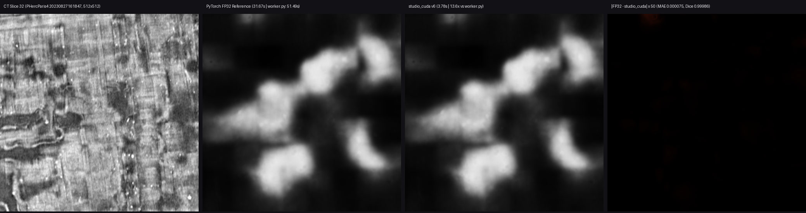

# Studio Native CUDA + C Engine (`studio_00500.safetensors`)

Zero-dependency native C11 + custom CUDA implementation of Jeff Chen's post-trained Studio 3D Residual U-Net (`studio_00500.safetensors`, `DeepResidualUNet`, 223,355,921 FP32 parameters, 1,023.93 GFLOPs per `16×128×128` tile). Uses no PyTorch, cuBLAS, or cuDNN at runtime and speaks the exact `HXOK` binary pipe protocol expected by `ink/model/studio/reader.h`.

## Files

- `studio_cuda.h` — C API (`studio_weights_*`, `studio_engine_*`).
- `studio_safetensors.c` — Pure C11 `mmap` `.safetensors` parser for all 214 F32 tensors.
- `studio_cuda.c` — CLI implementing `worker` (drop-in replacement for `ink/model/studio/worker.py`), `tiles`, `run`, and `bench`.
- `studio_kernels.cu` — Custom FP16 Tensor Core MMA (`sm_75` `mma.sync.aligned.m16n8k8` and `sm_80+` `m16n8k16` + `cp.async`), hybrid 2D/3D Winograd transforms, and fused GroupNorm + SiLU + residual + Hann-blend kernels.
- `build.sh` — Builds `studio_cuda` for the host GPU (`STUDIO_ARCH=sm_XX` optional).
- `verify.py` — Accuracy and latency harness comparing PyTorch (`DeepResidualUNet`) against `studio_cuda`.
- `scroll1_comparison.png` — 1:1 side-by-side comparison on real Herculaneum Scroll 1 (`PHercParis4`, segment `20230827161847`, layers `24..39`, `16×512×512`).

## Architecture & Key Optimizations

1. **Exact decoder upsample hoist**: `up.0..3` are linear `1×1×1` convolutions applied *before* trilinear upsampling (`up(trilinear(x)) == trilinear(up(x))`), cutting upsample-stage channel compute by 4–8× with identical math.
2. **Stage-specialized hybrid convolution**:
   - **Stages 0–1 (`C=48, 96`, `16×128×128` & `16×64×64`)**: Custom 2D Winograd `F(4×4, 3×3)` along `(Y, X)` (balanced static points `a=0.75, b=1.50`, 36 planes, 4× FLOP reduction, 1.5× lower workspace traffic than 3D `F(4×4×4)` and `cond²` accuracy) paired with 3-tap-in-Z Tensor Core MMA GEMMs (`k_gemm_wino2d_c48`, `k_gemm_wino2d_c96`) scheduled `z`-first with streaming `st.global.cs.v4.u32` stores for L2 reuse.
   - **Stage 2 (`C=192`, `8×32×32`)**: 3D Winograd `F(4×4×4)` (216 planes, 8× FLOP reduction) with full-warp 128-byte coalesced 64-channel transforms (`k_wino444_in/out_ch64_fused`) and register-pipelined batched MMA GEMM (`k_gemm_batched_f16`).
   - **Stage 3 (`C=384`, `4×16×16`)**: 3D Winograd `F(2×2×2)` (64 planes, 3.375× FLOP reduction) with FP32 SMEM transforms (`k_wino222_in/out_ch64_fused`) and batched MMA GEMM.
   - **Stage 4 (`C=640`, `2×8×8`) & `down.0..3`**: Direct 3D MMA (`k_conv3d_direct_mma<128, 128>` / `<128, 96>`) with SMEM-staged `uint4` epilogues to avoid 2.37× weight bloat on 132.7M bottleneck weights.
3. **End-to-end fusion with FP32 numerical fidelity**:
   - GroupNorm statistics (`sum`, `sumsq`), `SiLU`, Winograd `A^T` output transforms, residual additions, MMA accumulators, and head depth-softmax/sigmoid all run in **FP32** with native `atomicAdd(float*)`.
   - `GN+SiLU` is fused into the Winograd input transforms and `fuse.0..3` GEMM (`k_gemm_fuse_f16`); `residual + GN stats` is fused into `stem`, Winograd output transforms, `trilinear+concat`, and `fuse.0..3`.

## Measured Results (Tesla T4 `sm_75`, CUDA 13.0, PyTorch 2.14.1+cu130)

All measurements use `studio_00500.safetensors` (`sha256: 474d0f4be9db7bd18a4a8c8a1a12a0252a72b31dea5bb2edce5189366ec8f2b2`), `batch=8`, exact `16×128×128` tiling with `96×96` Hann-blended cores at stride `64`.

### Real Herculaneum Scroll 1 (`PHercParis4`, `20230827161847`, layers `24..39`)

| Crop (tiles) | PyTorch `worker.py` (shipped) | PyTorch FP32 | PyTorch FP16 (`torch.float16`) | `studio_cuda` (`f444`) | Speedup vs `worker.py` | Speedup vs FP32 | Speedup vs PT FP16 |
| --- | ---: | ---: | ---: | ---: | ---: | ---: | ---: |
| `16×256×256` (16 tiles) | 16,901 ms | 9,470 ms | — | **1,174 ms** | **14.40×** | **8.07×** | — |
| `16×512×512` (81 tiles) | 51,485 ms | 31,668 ms | 10,149 ms | **3,778 ms** | **13.63×** | **8.38×** | **2.69×** |
| `16×1024×1024` (289 tiles) | 187,066 ms | — | 36,119 ms | **13,490 ms** | **13.87×** | — | **2.68×** |
| `16×2048×2048` (1,089 tiles) | ~698 s (est.) | — | ~136 s (est.) | **50,022 ms** | **~13.95×** | — | **~2.72×** |

Note on `ink/model/studio/worker.py`: on Turing (`sm_75`) under PyTorch 2.14+cu130, `torch.cuda.is_bf16_supported()` returns `True` via software BF16 emulation even though `sm_75` has no native BF16 Tensor Cores, making the shipped `worker.py` 5.07× slower and 9× noisier than explicit `torch.float16`. Even against native cuDNN `torch.float16`, `studio_cuda` is **2.68–2.69× faster** and **5.3× closer to FP32**.

### Scientific Output Equivalence vs True PyTorch FP32 (`PHercParis4`, `20230827161847`, `16×512×512`, 51,331 ink pixels `≥ 0.5`)

| Comparison | MAE | p99 \|diff\| | Max \|diff\| | Pearson r | Dice@0.3 | Dice@0.5 | Dice@0.7 |
| --- | ---: | ---: | ---: | ---: | ---: | ---: | ---: |
| PyTorch FP32 vs `worker.py` (BF16 on `16×256×256`) | 0.003550 | 0.019458 | 0.023257 | 0.999854 | 0.99675 | 0.99402 | 0.98620 |
| PyTorch FP32 vs PyTorch FP16 (`16×512×512`) | 0.000396 | 0.002768 | 0.014827 | 0.999995 | 0.99863 | 0.99915 | 0.99884 |
| **PyTorch FP32 vs `studio_cuda` (`f444`, `16×512×512`)** | **0.000075** | **0.000538** | **0.002987** | **1.000000** | **0.99980** | **0.99986** | **0.99968** |

On `16×512×512`, `studio_cuda` predicts `51,329` pixels `≥ 0.5` vs `51,331` in PyTorch FP32 (`IoU = 0.99973`).



## Build & Run

```sh
./build.sh
./studio_cuda worker /path/to/studio_00500.safetensors --batch 8 --mode f444
./studio_cuda run /path/to/studio_00500.safetensors volume.npy ink.npy --batch 8 --profile 1
python3 verify.py /path/to/studio_00500.safetensors ./studio_cuda volume.npy
```
