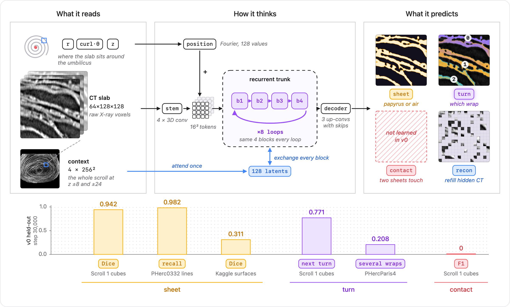
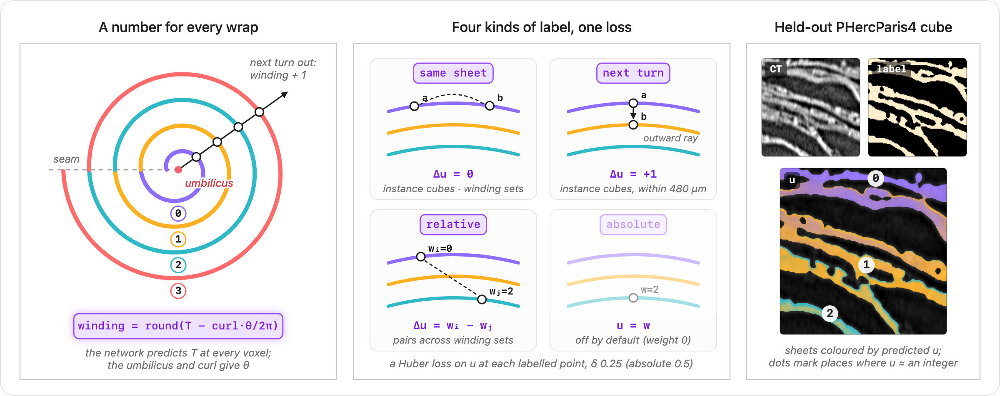
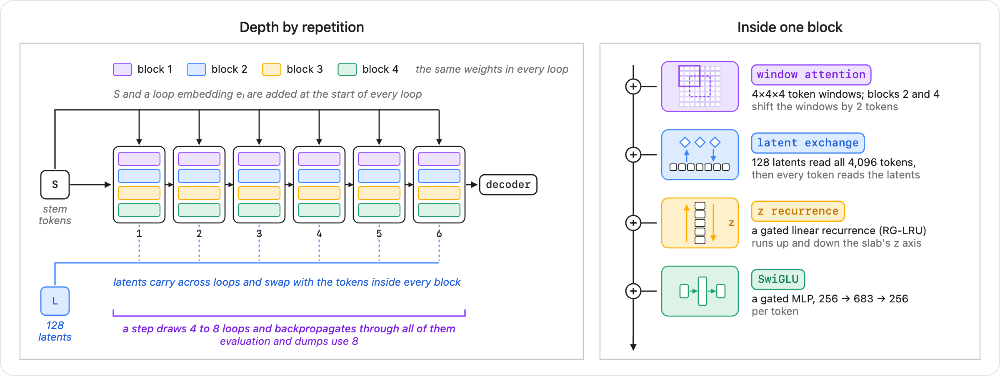
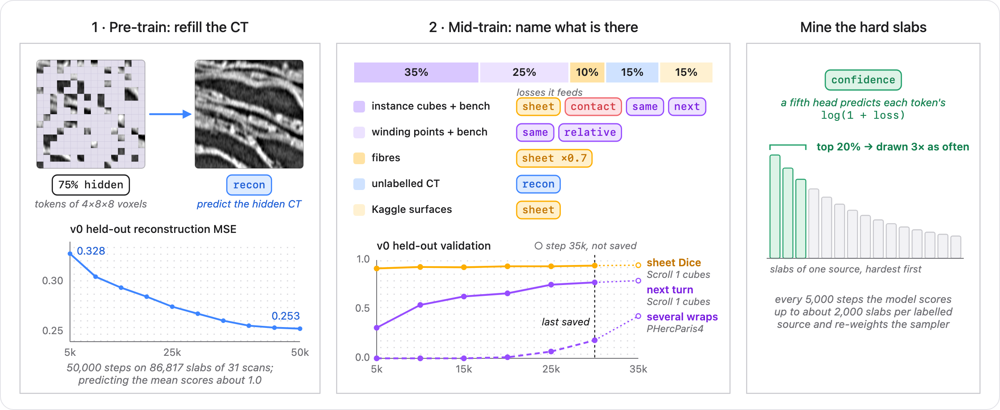
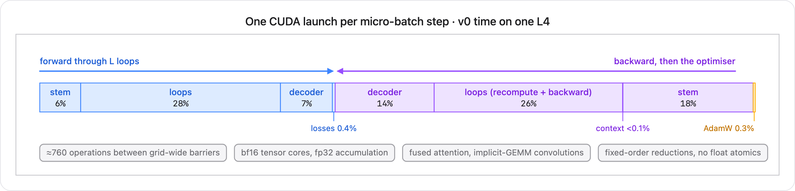
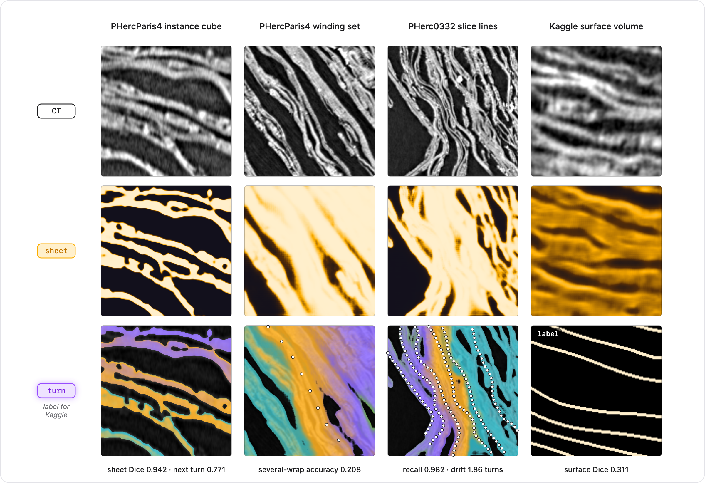

# LOGOS

LOGOS is an experimental CUDA model for papyrus geometry. It reads raw X-ray CT and predicts, for every voxel,
whether it is papyrus, which winding it belongs to and where different sheets touch. It also reconstructs masked CT
during self-supervised pre-training.

LOGOS is not part of the default HerculeX pipeline. The trace engine can read predicted fields with
`unroll-trace --field DIR`, but LOGOS does not yet write a tiled whole-scroll field. Checkpoints use the `logos`
header (and still load legacy `LOGOSCK1` v0 checkpoints).

The implementation is authoritative. [LOG.md](LOG.md) records the v0 training run and its measured results.

## How it works

<p></p>

LOGOS reads a CT slab with its position around the umbilicus and four whole-scroll context slices, loops four shared
blocks, and decodes sheet, turn, contact and reconstruction at every voxel. The bars are v0's held-out scores at step
30,000; the context thumbnail is a PHerc0139 cross-section.

<p></p>

The turn head predicts `T`. `u = T - curl·θ/2π` stays constant along a wrap and rises by one on the next wrap out, so
every winding label is a Huber loss on `u` at labelled points.

<p></p>

Each loop adds the stem tokens and a loop embedding, then runs the same four blocks. A training step draws 4–8 loops
and backpropagates through all of them.

<p></p>

Pre-training refills 75% of the CT tokens. Mid-training mixes the labelled sources by `MODEL_SHARES`, and every 5,000
steps the hardest fifth of each labelled source is drawn three times as often. The curves are v0's.

<p></p>

One cooperative launch runs each micro-batch step. On one L4, v0 spent 54% of its step time in the loops and 45% in
the full-resolution stem and decoder.

<p></p>

v0 at step 30,000 on held-out slabs: the PHercParis4 instance cube separates most wraps, the PHercParis4 winding set
and PHerc0332 slice lines merge neighbouring layers, and the Kaggle volume stays uncertain.

The figures are drawn by [`docs/source/logos/render.sh`](../../docs/source/logos/render.sh) from the v0 held-out dump.

## Status

- v0 trained on 26–27 November 2026 on one Colab L4 (the original run folder `data/outputs/runs/model/2026-11-26-v0` is a local training artifact not bundled in git).
- Post-run changes make `dump` unmasked, save at every validation and on `SIGTERM` or `SIGINT`, and add `--all-labels`.
- `model test` passes on an L4 and RTX 3090. The known `model model` gradient baseline is recorded in the log.
- Whole-scroll inference and direct trace-pipeline integration remain unfinished.

## Final architecture

The current model has 10,725,541 parameters. It uses bf16 weights and operands, fp32 accumulation, fp32 master
weights and fp32 AdamW moments.

### Inputs and outputs

Each record contains a `64×128×128` CT slab, four `256×256` cross-section context slices, the slab's box in that
context, an umbilicus point per CT slice, the scan curl and voxel size. Kaggle surface records have no scroll context
or umbilicus, so their positional and context features are zeroed.

| Output | Meaning |
| --- | --- |
| `sheet` | Per-voxel papyrus logit. |
| `turn` | Per-voxel continuous turn coordinate `T`; winding is `round(T - curl·angle/2π)`. |
| `contact` | Per-voxel logit for different sheets touching within one voxel. |
| `recon` | Reconstructed normalised CT for masked pre-training tokens. |
| `confidence` | Per-token prediction of `log(1 + token loss)`, used for hard-example mining. |

### Network as implemented

| Part | Implementation |
| --- | --- |
| Stem | Four 3D convolution stages: `1→32→64→128→256`, reducing the slab to `16×16×16` tokens. The three higher-resolution stages are kept as decoder skips. The first three stem stages and the decoder refinement convolutions use two-pass channel LayerNorm (`ε = 0.1`) and GELU; the final stem stage (`s3`) uses standard LayerNorm (`ε = 1e-5`), and the transposed-convolution upsamplers have neither. |
| Position | Radius and z scaled to 8 µm physical units (`voxel_um / 8`), plus curl-adjusted angle, are Fourier encoded to 128 values, projected to width 256 and added to the tokens. |
| Context | Two 2D context projections produce 256 tokens. A learned marker identifies the slab's context box. Training randomly drops context and positional features (`--nogeom-drop`, default `0.15`) so CT-only inference generalizes to axis-free fragments and Kaggle volumes. |
| Latents | 128 learned width-256 tokens cross-attend to the context once before the recurrent trunk. |
| Trunk | Four distinct blocks are reused for recurrent depth. Each block has `4×4×4` window attention, two-way latent exchange, bidirectional RG-LRU recurrence along z and a SwiGLU MLP. |
| Depth | Training draws 4–8 loops (`--loops-min`/`--loops-max`) and backpropagates through up to 8 (`--retain 8`) so the context encoder receives gradients on every step; AdamW skips context updates if `L > retain`. Evaluation and dumps use eight loops by default. There is no adaptive halting. |
| Decoder | Three transposed-convolution stages with skips return to full resolution, followed by four voxel heads. |

One cooperative CUDA launch runs a micro-batch step (forward, losses, backward, and AdamW on the final accumulation micro-batch), sized to every resident cooperative block the GPU supports. Matrix products use bf16 tensor cores with fp32 accumulation; attention is fused; convolutions are implicit GEMMs; weight gradients use fixed-order partial reductions without floating-point atomics. Training defaults to `--batch auto --accum auto`, automatically fitting the largest batch into 80% of free GPU VRAM (scaling across 24–96 GB GPUs such as 3090, L4, 4090, 5090, RTX 6000, and H100), maintaining effective batch ≥ 16, and scaling peak learning rate by `sqrt(effective_batch / 8)`.

## Data and losses

Training uses hand labels plus unlabelled CT for reconstruction. It does not use synthetic CT or another model's
predictions.

| Group | Source | Use |
| --- | --- | --- |
| Instance cubes | PHercParis4 `20230205180739`, 7.91 µm | Sheet, contact, same-sheet and physically bounded (`≤ 480 µm`) next-turn supervision. |
| Winding points | PHercParis4 `20260411134726`, 9.6 µm | Same-wrap and shift-invariant relative-winding supervision (cross-set pairs from `abs_winding`). |
| Bench training controls | `prep.sh bench` / `bench_to_shard.py` (`PHerc0139`, `PHerc0172`, `PHerc1667`, `PHercParis4`) | Multi-scroll published-mesh shards spanning 4 scrolls and 7.91–9.362 µm, built strictly from `train` zones (`val` and `holdout-A` excluded). `PHerc0139-train` (`< 0.5%` missing wraps) emits dense sheet/instance/winding labels; partial-annulus controls emit winding points only (`sheet=255`) so untraced wraps are never taught as air. |
| Fibres | Dataset001, Scroll 1 and PHerc0172 | Sparse positive sheet supervision (`0.1×` weight when negative labels are absent) at confidence 0.7. |
| Evaluation lines | PHercParis4 fibres and PHerc0332 slice lines and fibres | Held out for sheet and winding measurements. |
| Kaggle surfaces | Vesuvius Challenge Surface Detection volumes | Sheet supervision without scroll position or context (linearly rescaled to 8-bit). |
| Unlabelled CT | The scans in `scans.txt` | Masked reconstruction pre-training and the reconstruction share of mid-training. |

The losses are reconstruction MSE; calibrated sheet BCE (down-weighted on positive-only fibre slabs); capped-balance contact BCE (`pos_weight ≤ 15`); Huber losses for same-sheet, next-turn, and relative winding (absolute winding defaults to `--w-absolute 0` to keep `T` shift-invariant across scrolls); and confidence MSE against `log(1 + token loss)`. Labelled losses are multiplied by the source confidence.

Holdouts remain excluded by default. `MODEL_ALL_LABELS=1` also trains on held-out splits and evaluation lines; keep it off during evaluated runs and enable it only when explicitly training a final un-evaluated model.

## Record format

Shard files start with the `LGSF` header and contain one of three layouts: labelled, unlabelled or Kaggle surface.
Records use little endian and fixed `64×128×128` slabs.

- Labelled records contain CT, sheet labels, instance ids, context, centre line and up to 4,096 points.
- Unlabelled records contain uint8 CT, context and centre line.
- Kaggle surface records contain uint8 CT and sheet labels; label value 255 is unknown.

`prep.c` writes the format and `model.cu` reads it; those two files define its exact binary layout.

## Requirements

| Need | Detail |
| --- | --- |
| GPU | NVIDIA compute capability 8.0 or newer. v0 used one 24 GB Colab L4. |
| CUDA | `nvcc` with C++17. v0 used CUDA 13.0. |
| CPU tools | A C compiler, json-c, libtiff, libcurl, zlib and Blosc. |
| Data | Public Vesuvius CT and hand labels; Kaggle additionally requires an accepted competition account and token. |
| Disc | About 180 GB for the v0 pre-training, labelled, evaluation and Kaggle shards. |

## Workflow

Run these commands from this folder. Before running `colab.sh up` or `colab.sh push` from a fresh open-source checkout, download `SharpMeow/vesuvius-center-lines` into `../../records/umbilici/vesuvius-center-lines/`. Long Colab commands run as background jobs; `colab.sh log NAME` reports their output and exit code.

```bash
MODEL_SSH_KEY=~/.ssh/id_ed25519 ./colab.sh up
./colab.sh sh 'mkdir -p ~/.kaggle && cat > ~/.kaggle/access_token && chmod 600 ~/.kaggle/access_token' < ~/.kaggle/access_token
./colab.sh start kaggle 'bash labels.sh /content/model/raw kaggle-surface'
./colab.sh start prep 'bash prep.sh all'
./colab.sh log prep
./colab.sh sh 'bash build.sh model && /content/model/bin/model test'
./colab.sh start pre 'bash train.sh pre 50000'
./colab.sh start chain 'bash chain.sh'
./colab.sh start scrolls 'bash scrolls.sh PHerc1545_20250821151648 PHerc0826_20250821151701'
```

Copy checkpoints home as they are written:

```bash
./colab.sh get /content/model/runs/mid/step-N.ckpt LOCAL
```

On a Vast or standalone Linux GPU box (e.g. RTX 3090, 4090, 5090, RTX 6000, or single H100 — `model.cu` trains on one GPU and auto-sizes `--batch auto --accum auto` to fill 80% of free VRAM):

```bash
# 1. From your local checkout, sync the 1.2 GB training bench truth files (strictly *-train* controls; no holdout-A)
rsync -av --include='*/' --include='truth.npz' --exclude='*' \
  data/outputs/bench/controls/*-train*/ USER@BOX:/workspace/model/bench-controls/

# 2. On the GPU box (inside a HerculeX checkout, or with MODEL_ROOT/code + controls.json + umbilici/)
export MODEL_ROOT=/workspace/model
export MODEL_BENCH_CONTROLS=/workspace/model/bench-controls
cd ml-experimental/logos
bash labels.sh "$MODEL_ROOT/raw" kaggle-surface
bash prep.sh all                       # builds tools, pulls labels, builds bench + labelled + eval + unlabelled shards
bash build.sh model && "$MODEL_ROOT/bin/model" test
bash train.sh pre 50000                # or copy pre/step-50000.ckpt into $MODEL_ROOT/runs/pre/ to warm-start mid
bash chain.sh                          # rebuilds Kaggle shard with fixed 16-bit scaling, runs mid + eval + dump
```

### Next steps after validating trained weights

- Confirm fixed held-out metrics (`contact_f1`, `Kaggle Dice`, `PHerc0332` `lines_without_jumps` and drift, `relative_accuracy`) on the newly trained checkpoint before shipping weights.
- Implement tiled whole-scroll inference writing the field directory expected by `unroll-trace --field`.

## Commands

| Command | Role |
| --- | --- |
| `build.sh [all|tools|model]` | Build `fetch`, `prep` and the CUDA model. |
| `labels.sh [--list] DEST [SET ...]` | Fetch the published label sets. |
| `prep.sh build|pull|context|labelled|eval|unlabelled|all` | Prepare contexts and shards. |
| `train.sh pre STEPS` | Self-supervised reconstruction pre-training. |
| `train.sh mid STEPS` | Mid-training from the latest pre-training checkpoint. |
| `train.sh eval STAGE` | Evaluate the latest checkpoint on all held-out records. |
| `chain.sh` | Prepare the Kaggle shard, wait for pre-training, then run mid-training, evaluation and a dump. |
| `scrolls.sh SCROLL_SCAN ...` | Dump every prepared box of a scan unmasked and stitch the slabs into boxes. |
| `colab.sh up|push|sh|start|log|get|status|keepalive|down` | Operate the Colab runtime. |
| `model test|model|kernels|bench|train|eval|dump` | Test kernels and the model, benchmark, train, evaluate or dump predictions. |

The binary's main interfaces are:

```text
model train --stage pre|mid --shards DIR [--val DIR] [--resume CKPT] --out DIR [--steps N] [--seed S]
            [--shares instances,points,fibres,unlabelled,kaggle] [--all-labels 0|1]
model eval  --ckpt CKPT --shards DIR --out FILE.json [--loops 8] [--per-source N]
model dump  --ckpt CKPT --shards DIR --out DIR [--per-source 4] [--loops 8]
model bench --shards DIR [--stage pre|mid] [--steps 40]
```

## Settings

| Variable | Default | Effect |
| --- | --- | --- |
| `MODEL_ROOT` | `/content/model` | Runtime root containing code, binaries, data, shards, runs and jobs. |
| `MODEL_BIN` | `MODEL_ROOT/bin/model` | Model executable used by the scripts. |
| `MODEL_ARCH` | Current GPU | CUDA `sm_XX` target used by `build.sh model`. |
| `MODEL_BOXES` | `96` | Unlabelled `128×512×512` boxes per scan. |
| `MODEL_JOBS` | `8` | Parallel CT fetches during preparation. |
| `MODEL_SHARES` | `0.35,0.25,0.1,0.15,0.15` | Mid-training shares passed by `train.sh` and `chain.sh` for instances, winding points, fibres, unlabelled CT and Kaggle (`model train` itself defaults `--shares` to `0.4,0.25,0.15,0.2,0`). |
| `MODEL_MID_STEPS` | `50000` | Mid-training length used by `chain.sh`. |
| `MODEL_ALL_LABELS` | `0` | Include held-out and evaluation records when set to `1`. |
| `MODEL_STAGE` | `mid` | Checkpoint stage used by `scrolls.sh`. |
| `MODEL_SESSION`, `MODEL_GPU` | `model`, `L4` | Colab session name and GPU request. |

## Outputs and checks

Runs are stored under `MODEL_ROOT/runs/STAGE/`:

```text
train.jsonl                 losses, optimisation and performance every 100 steps
val.jsonl                   fixed held-out evaluation every 5,000 steps
gpu.csv                     GPU state once a minute
step-N.ckpt                 weights, optimiser moments and mining state
eval.json                   evaluation on every held-out record
dump/                       held-out slab predictions
scrolls/SCROLL_SCAN/        unmasked predictions stitched into boxes
```

Before another training run:

- Run `model test`; every native kernel is compared with a CPU double-precision reference.
- Run `model model`; compare its tensor-gradient output with the v0 baseline in [LOG.md](LOG.md), because the bf16
  objective makes its numerical check diagnostic rather than a clean pass/fail gate.
- Run `model bench --shards DIR` on the intended GPU.
- Run `./run.sh check lint` from the HerculeX root for the shell and source formatting checks.

## Limits

- `dump` processes independent slabs. Tiled whole-scroll inference with carried recurrence state is not implemented.
- LOGOS does not yet emit the field directory consumed by `unroll-trace --field`.
- The v0 contact head did not learn because the contact BCE was not balanced.
- v0 stopped before the planned end of mid-training; see [LOG.md](LOG.md).

## Files

| File | Role |
| --- | --- |
| `model.cu` | Final network, fused CUDA training and inference, losses, checkpointing and tests. |
| `prep.c`, `prep.sh`, `scans.txt` | Binary shard writer and the preparation workflow. |
| `fetch.c`, `fetch.h` | Byte-range CT box fetcher. |
| `labels.sh` | Published hand-labelled datasets. |
| `train.sh`, `chain.sh` | Training stages and unattended sequencing. |
| `scrolls.sh`, `stitch.py`, `boxes.py`, `slabs.py`, `curves.py` | Whole-scan boxes and result rendering. |
| `build.sh`, `colab.sh` | Native builds and Colab operation. |
| `LOG.md` | Training history, v0 measurements and known failures. |
